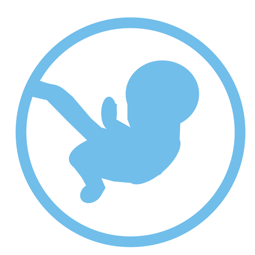
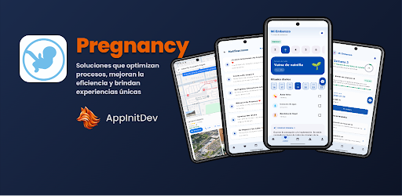
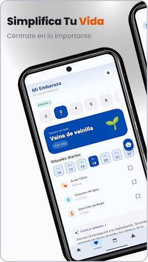
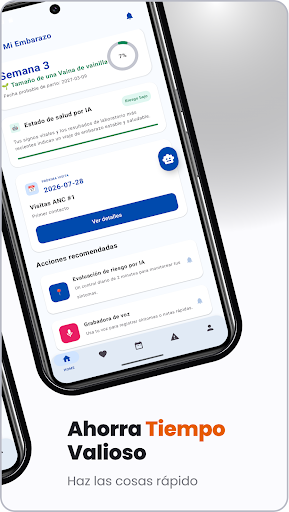
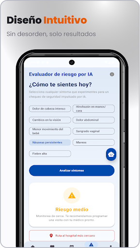
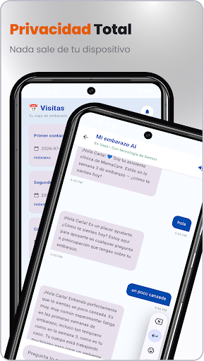
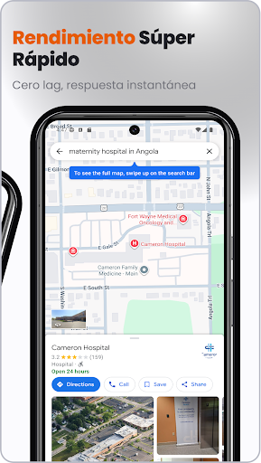
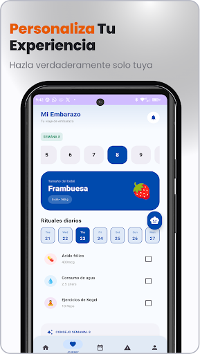
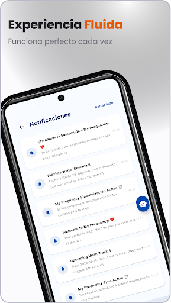
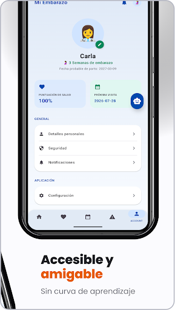

<!-- AppInitDev · README oficial de presentación · datos del catálogo facilitado -->

# My pregnancy: Calendario

**Calendario de la regla con síntomas, historial y ovulación estimada.**

 
 

## Código Kotlin de referencia

| Dato | Valor |
|---|---|
| Paquete Android | `com.appinitdev.development.free` |
| Versión seleccionada en el rastreo | `2.4.34` |
| Procedencia de versión | Gradle activo |
| Archivos Kotlin incluidos | 3 |

**Alcance:** este repositorio contiene una **copia parcial de código Kotlin**, con declaraciones `package` e `import` retiradas y posibles credenciales ofuscadas. No incluye Gradle, librerías, recursos ni archivos de configuración y **no compila directamente**. La eliminación automática de secretos es heurística: revisa todos los archivos antes de publicarlos. No se concede una licencia abierta de código de manera automática.

### Carpetas con código Kotlin

- [`app/src/main/java/com/appinitdev/development/auth/`](app/src/main/java/com/appinitdev/development/auth/)
- [`app/src/main/java/com/appinitdev/development/notifications/`](app/src/main/java/com/appinitdev/development/notifications/)

## En pocas palabras

Organiza el seguimiento de tu menstruación sin complicaciones: anota fechas, registra síntomas y consulta cómo cambian tus ciclos. Revisa las próximas fechas orientativas en el calendario.

**Ficha del proyecto**

| Dato | Información |
|---|---|
| Aplicación | My pregnancy: Calendario |
| Identificador Android | `com.appinitdev.development.free` |
| Categoría | Salud y bienestar |
| Edición de catálogo | `pregnancy-free` |
| Disponibilidad | [Consultar la ficha de Google Play](https://play.google.com/store/apps/details?id=com.appinitdev.development.free&hl=es&gl=mx) |

## Funcionalidades destacadas

- Calendario Menstrual: Realiza un seguimiento de tu ciclo y obtén predicciones para tus próximas menstruaciones.
- Registro de Síntomas: Anota tus estados de ánimo, la intensidad del flujo y los cambios físicos para comprender mejor tu cuerpo.
- Historial del Ciclo: Revisa tus patrones anteriores y la evolución de tus síntomas en una línea de tiempo organizada.
- ✨ Ovulación y Fertilidad: Consulta estimaciones de los días fértiles y la ovulación para facilitar tu planificación personal.
- Recordatorios Personalizados: Configura recordatorios personalizados para tu próxima regla, ovulación o registros diarios.

> **Nota importante:** Las predicciones del calendario son estimaciones orientativas y no sustituyen asesoramiento profesional ni un método anticonceptivo.

## Capturas de pantalla

<!-- APPINITDEV_IMAGEN_APPS_INICIO -->
Capturas originales de la aplicación, incorporadas desde el catálogo local de AppInitDev.

  
  
  
  

  
  
  
  

<!-- APPINITDEV_IMAGEN_APPS_FIN -->

## Primeros pasos

1. Introduce las fechas de inicio y fin de tu último período.
2. Registra diariamente tus síntomas, estado de ánimo y notas personales.
3. Deja que la aplicación calcule tus próximos ciclos y marque claramente tu ventana de fertilidad.

## Ecosistema AppInitDev

Además de la aplicación Android, el sitio de AppInitDev reúne experiencias y recursos que ayudan a conocer el proyecto:

- **Micrositio:** [Abrir](https://pregnancy-free.appinitdev.com/)
- **Demostración:** [Abrir](https://appinitdev.com/demos/apps/pregnancy-free/)
- **Laboratorio interactivo:** [Abrir](https://appinitdev.com/suite/experiencias/pregnancy-free/)
- **Directorio del proyecto:** [Abrir](https://appinitdev.com/directorios/pregnancy-free/)
- **Estudio y recursos:** [Abrir](https://appinitdev.com/apps-relacionadas/estudios/pregnancy-free/)

### Herramientas web complementarias

Utilidades disponibles en el navegador para explorar temas relacionados; no son necesariamente funciones integradas en la app.

- [Calendario de embarazo](https://appinitdev.com/herramientas/calendario-embarazo)
- [Calendario de ciclo](https://appinitdev.com/herramientas/calendario-ciclo)

### Guías relacionadas

- [Calendario embarazo consulta prenatal](https://appinitdev.com/guias/calendario-embarazo-consulta-prenatal)
- [Fecha probable parto calendario embarazo](https://appinitdev.com/guias/fecha-probable-parto-calendario-embarazo)

## Descubre otras aplicaciones

- [My pregnancy: Calendario — `pregnancy`](https://pregnancy.appinitdev.com/) · [Google Play](https://play.google.com/store/apps/details?id=com.appinitdev.pregnancy&hl=es&gl=mx)

## Enlaces de referencia

- [Google Play · My pregnancy: Calendario](https://play.google.com/store/apps/details?id=com.appinitdev.development.free&hl=es&gl=mx)
- [Portafolio AppInitDev](https://appinitdev.com/)
- [Todas las aplicaciones del desarrollador](https://play.google.com/store/apps/dev?id=6537616482020430815)
- [Herramientas web](https://appinitdev.com/herramientas/)
- [Guías y tutoriales](https://appinitdev.com/guias/)
- [Política de privacidad de la aplicación](https://appinitdev.com/privacy-policy?App=My%20Pregnancy)
- [Video de presentación](https://www.youtube.com/watch?v=ECHxFVY7Hzo)

## Contacto

¿Tienes comentarios o encontraste un problema? Puedes ponerte en contacto con el equipo desde [AppInitDev](https://appinitdev.com/contacts).

---
AppInitDev · Información basada en el catálogo facilitado (referencia: 21 de noviembre de 2026). Los precios, capturas, compatibilidad y disponibilidad pueden cambiar en Google Play. La exportación Kotlin de este repositorio es parcial y no equivale a un proyecto Android compilable.
