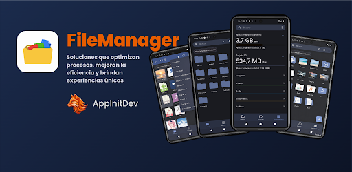
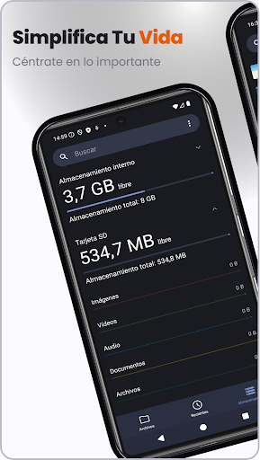
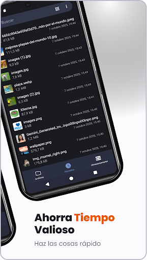
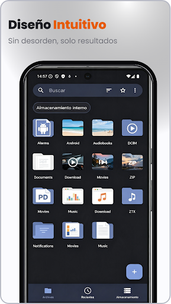
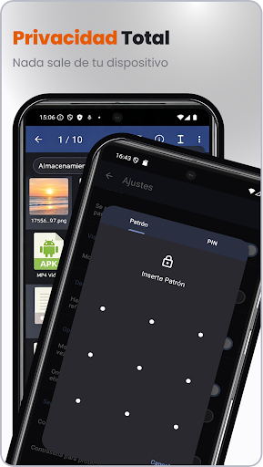
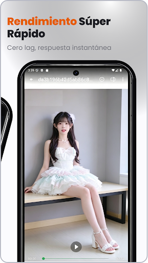
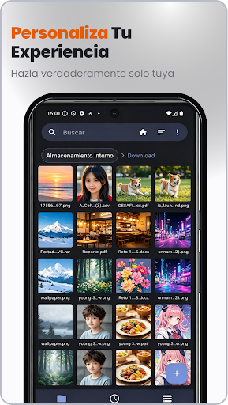
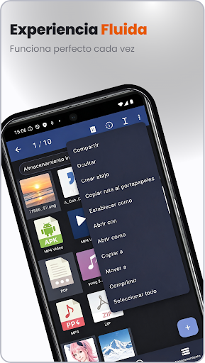
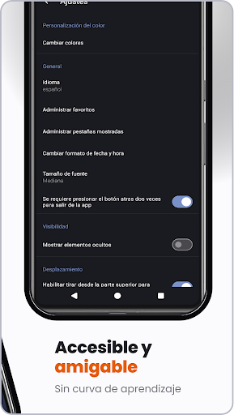

<!-- AppInitDev · README oficial de presentación · datos del catálogo facilitado -->

# FileManager: Gestor Archivos

**Gestor de archivos con envío por Wi-Fi y bloqueo de carpetas privadas.**

 
 

## Código Kotlin de referencia

| Dato | Valor |
|---|---|
| Paquete Android | `com.appinitdev.filefree` |
| Versión seleccionada en el rastreo | `1.26_Free` |
| Procedencia de versión | Gradle activo |
| Archivos Kotlin incluidos | 43 |

**Alcance:** este repositorio contiene una **copia parcial de código Kotlin**, con declaraciones `package` e `import` retiradas y posibles credenciales ofuscadas. No incluye Gradle, librerías, recursos ni archivos de configuración y **no compila directamente**. La eliminación automática de secretos es heurística: revisa todos los archivos antes de publicarlos. No se concede una licencia abierta de código de manera automática.

### Carpetas con código Kotlin

- [`app/src/androidTest/java/com/appinitdev/filefree/`](app/src/androidTest/java/com/appinitdev/filefree/)
- [`app/src/main/java/com/appinitdev/filefree/`](app/src/main/java/com/appinitdev/filefree/)
- [`app/src/main/java/com/appinitdev/filefree/activities/`](app/src/main/java/com/appinitdev/filefree/activities/)
- [`app/src/main/java/com/appinitdev/filefree/adapters/`](app/src/main/java/com/appinitdev/filefree/adapters/)
- [`app/src/main/java/com/appinitdev/filefree/ads/`](app/src/main/java/com/appinitdev/filefree/ads/)
- [`app/src/main/java/com/appinitdev/filefree/dialogs/`](app/src/main/java/com/appinitdev/filefree/dialogs/)
- [`app/src/main/java/com/appinitdev/filefree/extensions/`](app/src/main/java/com/appinitdev/filefree/extensions/)
- [`app/src/main/java/com/appinitdev/filefree/fragments/`](app/src/main/java/com/appinitdev/filefree/fragments/)
- [`app/src/main/java/com/appinitdev/filefree/helpers/`](app/src/main/java/com/appinitdev/filefree/helpers/)
- [`app/src/main/java/com/appinitdev/filefree/interfaces/`](app/src/main/java/com/appinitdev/filefree/interfaces/)
- [`app/src/main/java/com/appinitdev/filefree/models/`](app/src/main/java/com/appinitdev/filefree/models/)
- [`app/src/main/java/com/appinitdev/filefree/views/`](app/src/main/java/com/appinitdev/filefree/views/)
- [`app/src/test/java/com/appinitdev/filefree/`](app/src/test/java/com/appinitdev/filefree/)

## En pocas palabras

FileManager es un gestor de archivos para Android con el que puedes ordenar documentos y descargas, consultar el espacio ocupado y enviar archivos a tu ordenador por la red Wi-Fi local.

**Ficha del proyecto**

| Dato | Información |
|---|---|
| Aplicación | FileManager: Gestor Archivos |
| Identificador Android | `com.appinitdev.filefree` |
| Categoría | Herramientas |
| Edición de catálogo | `file-manager-free` |
| Disponibilidad | [Consultar la ficha de Google Play](https://play.google.com/store/apps/details?id=com.appinitdev.filefree&hl=es&gl=mx) |

## Funcionalidades destacadas

- Explorador de archivos: Copia, mueve, renombra y elimina documentos, fotografías y carpetas.
- Transferencia por Wi-Fi: Activa el servidor local FTP o HTTP y comparte ficheros con el ordenador conectado a la misma red.
- Análisis de almacenamiento: Localiza ficheros grandes y consulta el espacio ocupado antes de borrar contenido.
- Carpetas privadas: Limita el acceso con PIN, patrón o huella dactilar si el dispositivo lo permite.
- Archivos comprimidos: Crea ZIP y descomprime archivos ZIP o RAR compatibles.
- Otras herramientas: Accede a tarjetas SD y USB OTG compatibles, consulta archivos de texto y usa el modo oscuro.

## Capturas de pantalla

<!-- APPINITDEV_IMAGEN_APPS_INICIO -->
Capturas originales de la aplicación, incorporadas desde el catálogo local de AppInitDev.

  
  
  
  

  
  
  
  

<!-- APPINITDEV_IMAGEN_APPS_FIN -->

## Primeros pasos

1. Abre el explorador para visualizar el estado global de tu memoria interna.
2. Accede a las secciones automáticas por tipo de fichero o emplea el buscador inteligente.
3. Activa la función de transferencia local e introduce la dirección en el navegador de tu ordenador.
4. Guarda los documentos sensibles en la carpeta protegida para salvaguardar tu intimidad.

## Ecosistema AppInitDev

Además de la aplicación Android, el sitio de AppInitDev reúne experiencias y recursos que ayudan a conocer el proyecto:

- **Micrositio:** [Abrir](https://file-manager-free.appinitdev.com/)
- **Demostración:** [Abrir](https://appinitdev.com/demos/apps/file-manager-free/)
- **Laboratorio interactivo:** [Abrir](https://appinitdev.com/suite/experiencias/file-manager-free/)
- **Directorio del proyecto:** [Abrir](https://appinitdev.com/directorios/file-manager-free/)
- **Estudio y recursos:** [Abrir](https://appinitdev.com/apps-relacionadas/estudios/file-manager-free/)

### Herramientas web complementarias

Utilidades disponibles en el navegador para explorar temas relacionados; no son necesariamente funciones integradas en la app.

- [Detector de formatos](https://appinitdev.com/herramientas/detector-formato-archivo)
- [Comprimir archivos](https://appinitdev.com/herramientas/comprimir-archivo-gzip)
- [Descomprimir archivos](https://appinitdev.com/herramientas/descomprimir-archivo-gzip)
- [Tamaño de archivos](https://appinitdev.com/herramientas/bytes-legibles)

### Guías relacionadas

- [Backup 321 archivos cifrados android](https://appinitdev.com/guias/backup-321-archivos-cifrados-android)
- [Checksum integridad archivos](https://appinitdev.com/guias/checksum-integridad-archivos)

## Descubre otras aplicaciones

- [FileManager: Gestor Archivos — `file-explorer`](https://file-explorer.appinitdev.com/) · [Google Play](https://play.google.com/store/apps/details?id=com.appinitdev.fileExplorer&hl=es&gl=mx)

## Enlaces de referencia

- [Google Play · FileManager: Gestor Archivos](https://play.google.com/store/apps/details?id=com.appinitdev.filefree&hl=es&gl=mx)
- [Portafolio AppInitDev](https://appinitdev.com/)
- [Todas las aplicaciones del desarrollador](https://play.google.com/store/apps/dev?id=6537616482020430815)
- [Herramientas web](https://appinitdev.com/herramientas/)
- [Guías y tutoriales](https://appinitdev.com/guias/)
- [Política de privacidad de la aplicación](https://appinitdev.com/privacy-policy?App=File%20Manager)
- [Video de presentación](https://www.youtube.com/watch?v=Urjhg-UIIF8)

## Contacto

¿Tienes comentarios o encontraste un problema? Puedes ponerte en contacto con el equipo desde [AppInitDev](https://appinitdev.com/contacts).

---
AppInitDev · Información basada en el catálogo facilitado (referencia: 21 de noviembre de 2026). Los precios, capturas, compatibilidad y disponibilidad pueden cambiar en Google Play. La exportación Kotlin de este repositorio es parcial y no equivale a un proyecto Android compilable.
