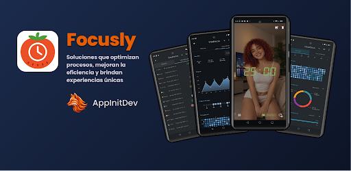
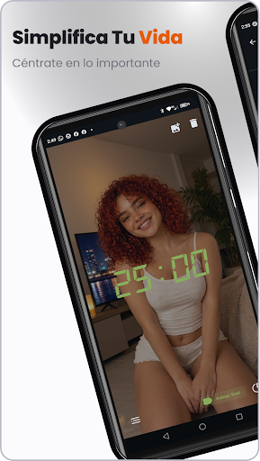
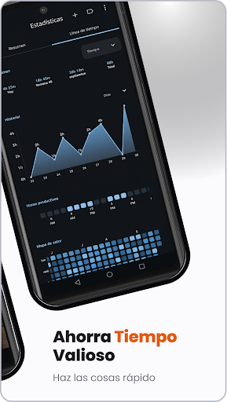
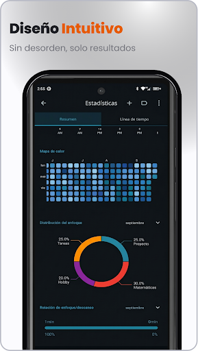
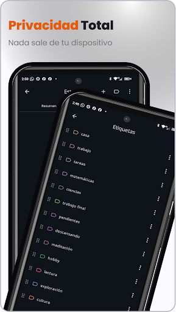
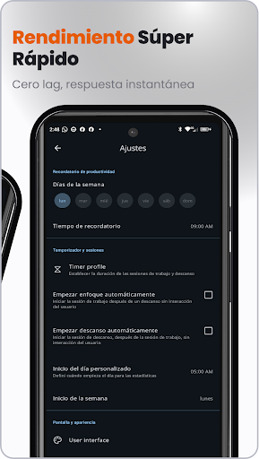
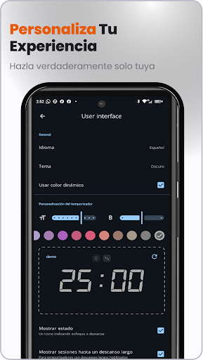
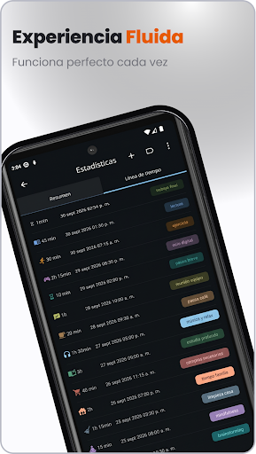
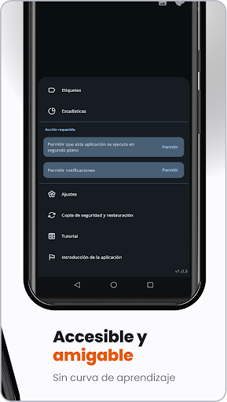

<!-- AppInitDev · README oficial de presentación · datos del catálogo facilitado -->

# Focusly: Temporizador Pomodoro

**Temporizador Pomodoro para estudiar y trabajar con control del tiempo.**

 
 

## Código Kotlin de referencia

| Dato | Valor |
|---|---|
| Paquete Android | `com.appinitdev.goodtime` |
| Versión seleccionada en el rastreo | `1.0.4` |
| Procedencia de versión | Gradle activo |
| Archivos Kotlin incluidos | 61 |

**Alcance:** este repositorio contiene una **copia parcial de código Kotlin**, con declaraciones `package` e `import` retiradas y posibles credenciales ofuscadas. No incluye Gradle, librerías, recursos ni archivos de configuración y **no compila directamente**. La eliminación automática de secretos es heurística: revisa todos los archivos antes de publicarlos. No se concede una licencia abierta de código de manera automática.

### Carpetas con código Kotlin

- [`app/src/androidTest/java/com/appinitdev/goodtime/`](app/src/androidTest/java/com/appinitdev/goodtime/)
- [`app/src/main/java/com/appinitdev/goodtime/`](app/src/main/java/com/appinitdev/goodtime/)
- [`app/src/main/java/com/appinitdev/goodtime/backup/`](app/src/main/java/com/appinitdev/goodtime/backup/)
- [`app/src/main/java/com/appinitdev/goodtime/billing/`](app/src/main/java/com/appinitdev/goodtime/billing/)
- [`app/src/main/java/com/appinitdev/goodtime/bl/`](app/src/main/java/com/appinitdev/goodtime/bl/)
- [`app/src/main/java/com/appinitdev/goodtime/bl/media/`](app/src/main/java/com/appinitdev/goodtime/bl/media/)
- [`app/src/main/java/com/appinitdev/goodtime/bl/multiplayer/`](app/src/main/java/com/appinitdev/goodtime/bl/multiplayer/)
- [`app/src/main/java/com/appinitdev/goodtime/bl/notifications/`](app/src/main/java/com/appinitdev/goodtime/bl/notifications/)
- [`app/src/main/java/com/appinitdev/goodtime/bl/sensors/`](app/src/main/java/com/appinitdev/goodtime/bl/sensors/)
- [`app/src/main/java/com/appinitdev/goodtime/bl/wear/`](app/src/main/java/com/appinitdev/goodtime/bl/wear/)
- [`app/src/main/java/com/appinitdev/goodtime/common/`](app/src/main/java/com/appinitdev/goodtime/common/)
- [`app/src/main/java/com/appinitdev/goodtime/data/backup/`](app/src/main/java/com/appinitdev/goodtime/data/backup/)
- [`app/src/main/java/com/appinitdev/goodtime/health/`](app/src/main/java/com/appinitdev/goodtime/health/)
- [`app/src/main/java/com/appinitdev/goodtime/labels/`](app/src/main/java/com/appinitdev/goodtime/labels/)
- [`app/src/main/java/com/appinitdev/goodtime/labels/addedit/`](app/src/main/java/com/appinitdev/goodtime/labels/addedit/)
- [`app/src/main/java/com/appinitdev/goodtime/labels/archived/`](app/src/main/java/com/appinitdev/goodtime/labels/archived/)
- Y 2 carpetas adicionales de Kotlin.

## En pocas palabras

Planifica tus horas de estudio y trabajo con Focusly. Combina intervalos Pomodoro y descansos para organizarte mejor, o activa el cronómetro si quieres medir el tiempo sin una duración predefinida.

**Ficha del proyecto**

| Dato | Información |
|---|---|
| Aplicación | Focusly: Temporizador Pomodoro |
| Identificador Android | `com.appinitdev.goodtime` |
| Categoría | Productividad |
| Edición de catálogo | `goodtime` |
| Disponibilidad | [Consultar la ficha de Google Play](https://play.google.com/store/apps/details?id=com.appinitdev.goodtime&hl=es&gl=mx) |

## Funcionalidades destacadas

- Personaliza la duración del trabajo y los descansos
- Controla sesiones abiertas con el cronómetro ascendente
- Consulta el historial y las estadísticas de tiempo
- Clasifica asignaturas y proyectos con colores y notas
- Trabaja con una interfaz clara y opciones de color

## Capturas de pantalla

<!-- APPINITDEV_IMAGEN_APPS_INICIO -->
Capturas originales de la aplicación, incorporadas desde el catálogo local de AppInitDev.

  
  
  
  

  
  
  
  

<!-- APPINITDEV_IMAGEN_APPS_FIN -->

## Cómo empezar

1. Abre la [ficha oficial de Focusly: Temporizador Pomodoro](https://play.google.com/store/apps/details?id=com.appinitdev.goodtime&hl=es&gl=mx) y revisa la compatibilidad de tu dispositivo.
2. Instala la aplicación siguiendo las instrucciones de Google Play.
3. Explora sus funciones desde la interfaz de la aplicación.

## Ecosistema AppInitDev

Además de la aplicación Android, el sitio de AppInitDev reúne experiencias y recursos que ayudan a conocer el proyecto:

- **Micrositio:** [Abrir](https://goodtime.appinitdev.com/)
- **Demostración:** [Abrir](https://appinitdev.com/demos/apps/goodtime/)
- **Laboratorio interactivo:** [Abrir](https://appinitdev.com/suite/experiencias/goodtime/)
- **Directorio del proyecto:** [Abrir](https://appinitdev.com/directorios/goodtime/)
- **Estudio y recursos:** [Abrir](https://appinitdev.com/apps-relacionadas/estudios/goodtime/)

### Herramientas web complementarias

Utilidades disponibles en el navegador para explorar temas relacionados; no son necesariamente funciones integradas en la app.

- [Planificador Pomodoro](https://appinitdev.com/herramientas/pomodoro-plan)
- [Organizador de tareas](https://appinitdev.com/herramientas/ordenar-tareas)
- [Bloques de concentración](https://appinitdev.com/herramientas/bloques-profundos)
- [Agenda de tiempo](https://appinitdev.com/herramientas/agenda-tiempo)

### Guías relacionadas

- [Plan cuatro pomodoros](https://appinitdev.com/guias/plan-cuatro-pomodoros)
- [Tecnica pomodoro estudiar](https://appinitdev.com/guias/tecnica-pomodoro-estudiar)

## Descubre otras aplicaciones

- [Nexus Local: Gestor Web Wi-Fi — `nexuslocal`](https://nexuslocal.appinitdev.com/) · [Google Play](https://play.google.com/store/apps/details?id=com.appinitdev.nexusLocal&hl=es&gl=mx)
- [Notepad: Bloc de notas tareas — `notes-premium`](https://notes-premium.appinitdev.com/) · [Google Play](https://play.google.com/store/apps/details?id=com.appinitdev.notes.premium&hl=es&gl=mx)
- [Notepad: Bloc de notas tareas — `notes-free`](https://notes-free.appinitdev.com/) · [Google Play](https://play.google.com/store/apps/details?id=com.appinitdev.notes.free&hl=es&gl=mx)

## Enlaces de referencia

- [Google Play · Focusly: Temporizador Pomodoro](https://play.google.com/store/apps/details?id=com.appinitdev.goodtime&hl=es&gl=mx)
- [Portafolio AppInitDev](https://appinitdev.com/)
- [Todas las aplicaciones del desarrollador](https://play.google.com/store/apps/dev?id=6537616482020430815)
- [Herramientas web](https://appinitdev.com/herramientas/)
- [Guías y tutoriales](https://appinitdev.com/guias/)
- [Política de privacidad de la aplicación](https://appinitdev.com/privacy-policy?App=Focusly)
- [Video de presentación](https://www.youtube.com/watch?v=MZMaSDqFwYs)

## Contacto

¿Tienes comentarios o encontraste un problema? Puedes ponerte en contacto con el equipo desde [AppInitDev](https://appinitdev.com/contacts).

---
AppInitDev · Información basada en el catálogo facilitado (referencia: 21 de noviembre de 2026). Los precios, capturas, compatibilidad y disponibilidad pueden cambiar en Google Play. La exportación Kotlin de este repositorio es parcial y no equivale a un proyecto Android compilable.
