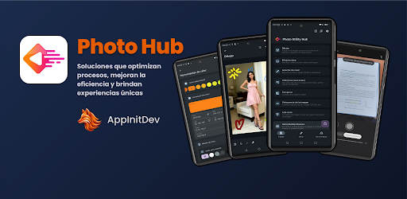
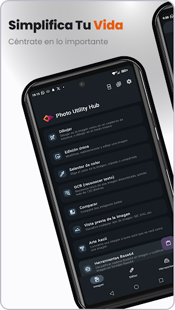
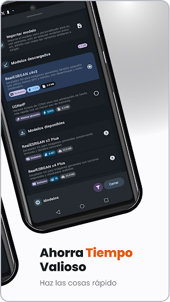
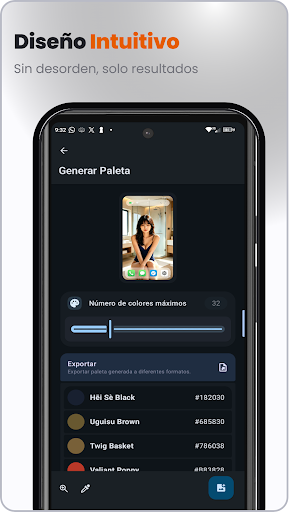
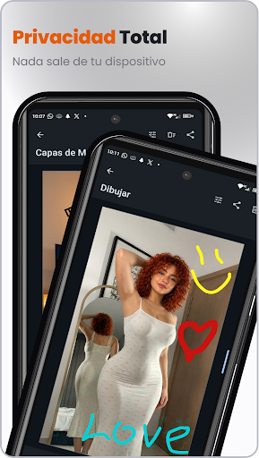
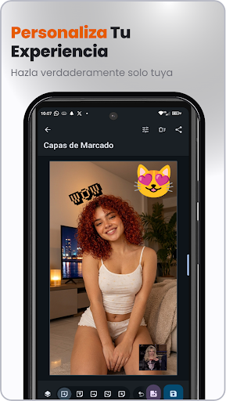
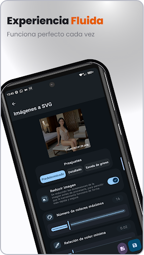
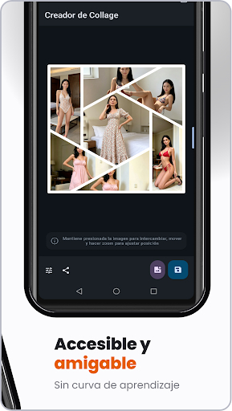

<!-- AppInitDev · README oficial de presentación · datos del catálogo facilitado -->

# Photo Utility Hub: Editor IA

**Edita fotos con IA, elimina fondos y convierte archivos de imagen.**

 
 

## Código Kotlin de referencia

| Dato | Valor |
|---|---|
| Paquete Android | `com.appinitdev.imagetools` |
| Versión seleccionada en el rastreo | `1.2.10_Free` |
| Procedencia de versión | Gradle activo |
| Archivos Kotlin incluidos | 13 |

**Alcance:** este repositorio contiene una **copia parcial de código Kotlin**, con declaraciones `package` e `import` retiradas y posibles credenciales ofuscadas. No incluye Gradle, librerías, recursos ni archivos de configuración y **no compila directamente**. La eliminación automática de secretos es heurística: revisa todos los archivos antes de publicarlos. No se concede una licencia abierta de código de manera automática.

### Carpetas con código Kotlin

- [`app/src/main/java/com/t8rin/imagetoolbox/app/presentation/`](app/src/main/java/com/t8rin/imagetoolbox/app/presentation/)
- [`app/src/main/java/com/t8rin/imagetoolbox/app/presentation/components/`](app/src/main/java/com/t8rin/imagetoolbox/app/presentation/components/)
- [`app/src/main/java/com/t8rin/imagetoolbox/app/presentation/components/functions/`](app/src/main/java/com/t8rin/imagetoolbox/app/presentation/components/functions/)
- [`app/src/main/java/com/t8rin/imagetoolbox/app/presentation/components/utils/`](app/src/main/java/com/t8rin/imagetoolbox/app/presentation/components/utils/)

## En pocas palabras

Con Photo Utility Hub puedes retocar fotografías y convertir archivos de imagen desde una misma aplicación. Prepara imágenes para tus proyectos, elimina fondos y cambia de formato cuando lo necesites.

**Ficha del proyecto**

| Dato | Información |
|---|---|
| Aplicación | Photo Utility Hub: Editor IA |
| Identificador Android | `com.appinitdev.imagetools` |
| Categoría | Arte y diseño |
| Edición de catálogo | `imagetools` |
| Disponibilidad | [Consultar la ficha de Google Play](https://play.google.com/store/apps/details?id=com.appinitdev.imagetools&hl=es&gl=mx) |

## Funcionalidades destacadas

- Mejora de imagen con IA para recuperar detalle y reducir ruido.
- Eliminador de fondos para aislar personas u objetos de una fotografía.
- Filtros y efectos para cambiar el aspecto de las imágenes.
- Conversión entre formatos compatibles, como HEIF, AVIF, WebP y PDF.

## Capturas de pantalla

<!-- APPINITDEV_IMAGEN_APPS_INICIO -->
Capturas originales de la aplicación, incorporadas desde el catálogo local de AppInitDev.

  
  
  
  

  
  
  
  

<!-- APPINITDEV_IMAGEN_APPS_FIN -->

## Cómo empezar

1. Abre la [ficha oficial de Photo Utility Hub: Editor IA](https://play.google.com/store/apps/details?id=com.appinitdev.imagetools&hl=es&gl=mx) y revisa la compatibilidad de tu dispositivo.
2. Instala la aplicación siguiendo las instrucciones de Google Play.
3. Explora sus funciones desde la interfaz de la aplicación.

## Ecosistema AppInitDev

Además de la aplicación Android, el sitio de AppInitDev reúne experiencias y recursos que ayudan a conocer el proyecto:

- **Micrositio:** [Abrir](https://imagetools.appinitdev.com/)
- **Demostración:** [Abrir](https://appinitdev.com/demos/apps/imagetools/)
- **Laboratorio interactivo:** [Abrir](https://appinitdev.com/suite/experiencias/imagetools/)
- **Directorio del proyecto:** [Abrir](https://appinitdev.com/directorios/imagetools/)
- **Estudio y recursos:** [Abrir](https://appinitdev.com/apps-relacionadas/estudios/imagetools/)

### Herramientas web complementarias

Utilidades disponibles en el navegador para explorar temas relacionados; no son necesariamente funciones integradas en la app.

- [Eliminar metadatos de imágenes](https://appinitdev.com/herramientas/imagen-remove-exif)
- [Comprimir imágenes](https://appinitdev.com/herramientas/imagen-compress)
- [Redimensionar imágenes](https://appinitdev.com/herramientas/imagen-resize)
- [Crear transparencia](https://appinitdev.com/herramientas/imagen-transparent-color)

### Guías relacionadas

- [Compartir fotos privadas mensajeria](https://appinitdev.com/guias/compartir-fotos-privadas-mensajeria)
- [Crear puzzles fotos familiares consejos](https://appinitdev.com/guias/crear-puzzles-fotos-familiares-consejos)

## Descubre otras aplicaciones

- [Photo Utility Hub: Editor IA — `imagetools-pro`](https://imagetools-pro.appinitdev.com/) · [Google Play](https://play.google.com/store/apps/details?id=com.appinitdev.imagetools.pro&hl=es&gl=mx)

## Enlaces de referencia

- [Google Play · Photo Utility Hub: Editor IA](https://play.google.com/store/apps/details?id=com.appinitdev.imagetools&hl=es&gl=mx)
- [Portafolio AppInitDev](https://appinitdev.com/)
- [Todas las aplicaciones del desarrollador](https://play.google.com/store/apps/dev?id=6537616482020430815)
- [Herramientas web](https://appinitdev.com/herramientas/)
- [Guías y tutoriales](https://appinitdev.com/guias/)
- [Política de privacidad de la aplicación](https://appinitdev.com/privacy-policy?App=Photo%20Utility%20Hub)
- [Video de presentación](https://www.youtube.com/watch?v=2eJYfzBZEeQ)

## Contacto

¿Tienes comentarios o encontraste un problema? Puedes ponerte en contacto con el equipo desde [AppInitDev](https://appinitdev.com/contacts).

---
AppInitDev · Información basada en el catálogo facilitado (referencia: 21 de noviembre de 2026). Los precios, capturas, compatibilidad y disponibilidad pueden cambiar en Google Play. La exportación Kotlin de este repositorio es parcial y no equivale a un proyecto Android compilable.
