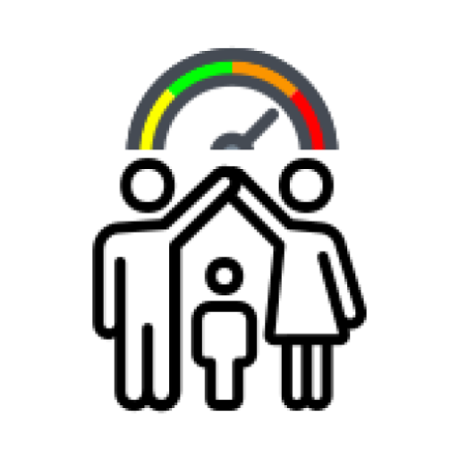
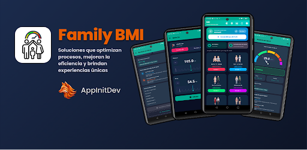
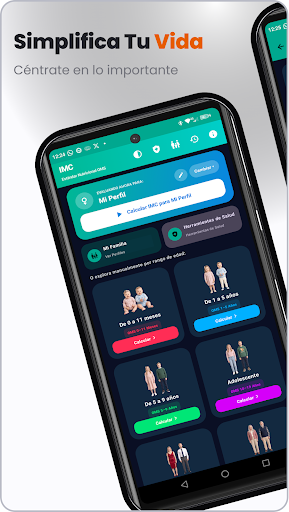
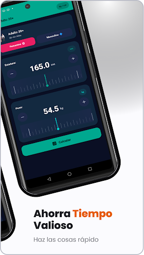
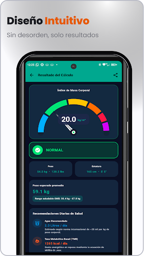
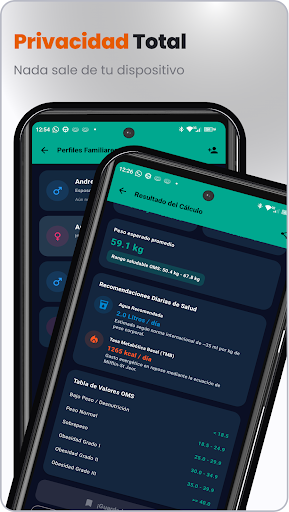
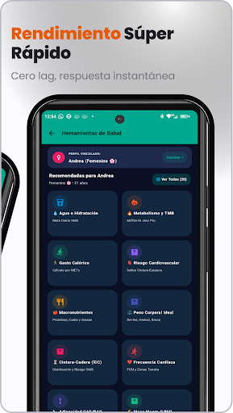
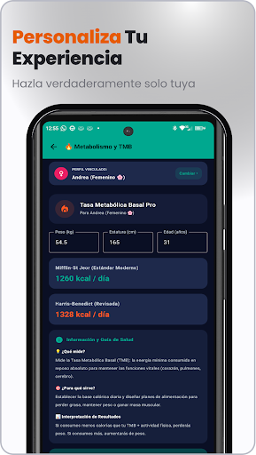
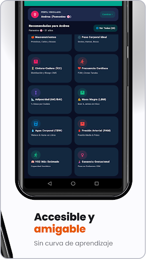

<!-- AppInitDev · README oficial de presentación · datos del catálogo facilitado -->

# Family BMI: Calculadora IMC

**Calcula el IMC y registra el peso y la altura de toda la familia.**

 
 

## Código Kotlin de referencia

| Dato | Valor |
|---|---|
| Paquete Android | `com.appinitdev.imc` |
| Versión seleccionada en el rastreo | `2.4.7` |
| Procedencia de versión | Gradle activo |
| Archivos Kotlin incluidos | 42 |

**Alcance:** este repositorio contiene una **copia parcial de código Kotlin**, con declaraciones `package` e `import` retiradas y posibles credenciales ofuscadas. No incluye Gradle, librerías, recursos ni archivos de configuración y **no compila directamente**. La eliminación automática de secretos es heurística: revisa todos los archivos antes de publicarlos. No se concede una licencia abierta de código de manera automática.

### Carpetas con código Kotlin

- [`app/src/androidTest/java/com/appinitdev/imc/`](app/src/androidTest/java/com/appinitdev/imc/)
- [`app/src/main/java/com/appinitdev/imc/`](app/src/main/java/com/appinitdev/imc/)
- [`app/src/main/java/com/appinitdev/imc/ui/components/`](app/src/main/java/com/appinitdev/imc/ui/components/)
- [`app/src/main/java/com/appinitdev/imc/ui/screens/`](app/src/main/java/com/appinitdev/imc/ui/screens/)
- [`app/src/main/java/com/appinitdev/imc/ui/theme/`](app/src/main/java/com/appinitdev/imc/ui/theme/)
- [`app/src/test/java/com/appinitdev/imc/`](app/src/test/java/com/appinitdev/imc/)

## En pocas palabras

Family BMI es una calculadora del índice de masa corporal (IMC) con un registro de peso y altura para cada miembro de la familia. Organiza las mediciones mediante perfiles individuales.

**Ficha del proyecto**

| Dato | Información |
|---|---|
| Aplicación | Family BMI: Calculadora IMC |
| Identificador Android | `com.appinitdev.imc` |
| Categoría | Salud y bienestar |
| Edición de catálogo | `imc` |
| Disponibilidad | [Consultar la ficha de Google Play](https://play.google.com/store/apps/details?id=com.appinitdev.imc&hl=es&gl=mx) |

## Funcionalidades destacadas

- Introduce el peso y la altura para calcular el IMC. Consulta el historial y los gráficos para observar la evolución de las mediciones. Cada persona mantiene su propio seguimiento.
- Crea un perfil, añade una medición y revisa el resultado y el historial cuando quieras. Una forma práctica de llevar tus registros diarios.

> **Nota importante:** El IMC es una referencia general y no constituye por sí solo un diagnóstico médico.

## Capturas de pantalla

<!-- APPINITDEV_IMAGEN_APPS_INICIO -->
Capturas originales de la aplicación, incorporadas desde el catálogo local de AppInitDev.

  
  
  
  

  
  
  
  

<!-- APPINITDEV_IMAGEN_APPS_FIN -->

## Cómo empezar

1. Abre la [ficha oficial de Family BMI: Calculadora IMC](https://play.google.com/store/apps/details?id=com.appinitdev.imc&hl=es&gl=mx) y revisa la compatibilidad de tu dispositivo.
2. Instala la aplicación siguiendo las instrucciones de Google Play.
3. Explora sus funciones desde la interfaz de la aplicación.

## Ecosistema AppInitDev

Además de la aplicación Android, el sitio de AppInitDev reúne experiencias y recursos que ayudan a conocer el proyecto:

- **Micrositio:** [Abrir](https://imc.appinitdev.com/)
- **Demostración:** [Abrir](https://appinitdev.com/demos/apps/imc/)
- **Laboratorio interactivo:** [Abrir](https://appinitdev.com/suite/experiencias/imc/)
- **Directorio del proyecto:** [Abrir](https://appinitdev.com/directorios/imc/)
- **Estudio y recursos:** [Abrir](https://appinitdev.com/apps-relacionadas/estudios/imc/)

### Herramientas web complementarias

Utilidades disponibles en el navegador para explorar temas relacionados; no son necesariamente funciones integradas en la app.

- [Calculadora de IMC para adultos](https://appinitdev.com/herramientas/imc-adulto)

### Guías relacionadas

- [Calcular imc limitaciones](https://appinitdev.com/guias/calcular-imc-limitaciones)
- [Imc infantil percentiles diferencias adultos](https://appinitdev.com/guias/imc-infantil-percentiles-diferencias-adultos)

## Descubre otras aplicaciones

- [Fertility: Ciclo y Ovulación — `fertilitybaby`](https://fertilitybaby.appinitdev.com/) · [Google Play](https://play.google.com/store/apps/details?id=com.appinitdev.fertilitybaby&hl=es&gl=mx)
- [My pregnancy: Calendario — `pregnancy-free`](https://pregnancy-free.appinitdev.com/) · [Google Play](https://play.google.com/store/apps/details?id=com.appinitdev.development.free&hl=es&gl=mx)
- [My pregnancy: Calendario — `pregnancy`](https://pregnancy.appinitdev.com/) · [Google Play](https://play.google.com/store/apps/details?id=com.appinitdev.pregnancy&hl=es&gl=mx)

## Enlaces de referencia

- [Google Play · Family BMI: Calculadora IMC](https://play.google.com/store/apps/details?id=com.appinitdev.imc&hl=es&gl=mx)
- [Portafolio AppInitDev](https://appinitdev.com/)
- [Todas las aplicaciones del desarrollador](https://play.google.com/store/apps/dev?id=6537616482020430815)
- [Herramientas web](https://appinitdev.com/herramientas/)
- [Guías y tutoriales](https://appinitdev.com/guias/)
- [Política de privacidad de la aplicación](https://appinitdev.com/privacy-policy?App=Family%20BMI)

## Contacto

¿Tienes comentarios o encontraste un problema? Puedes ponerte en contacto con el equipo desde [AppInitDev](https://appinitdev.com/contacts).

---
AppInitDev · Información basada en el catálogo facilitado (referencia: 21 de noviembre de 2026). Los precios, capturas, compatibilidad y disponibilidad pueden cambiar en Google Play. La exportación Kotlin de este repositorio es parcial y no equivale a un proyecto Android compilable.
