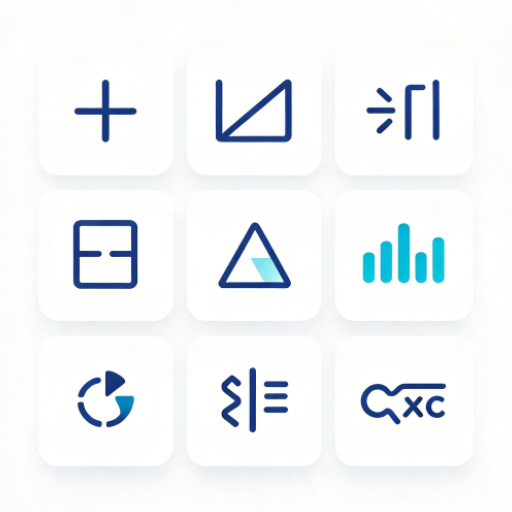
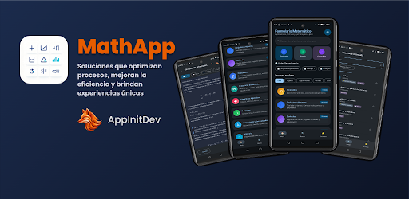
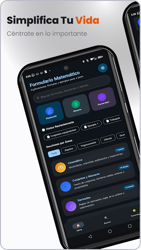
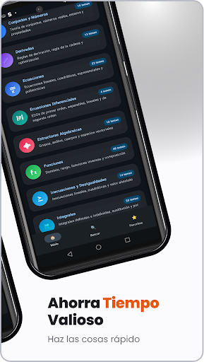
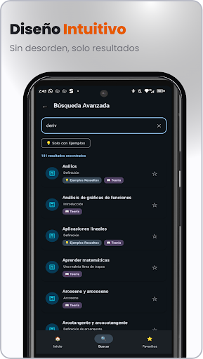
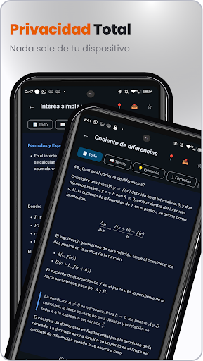
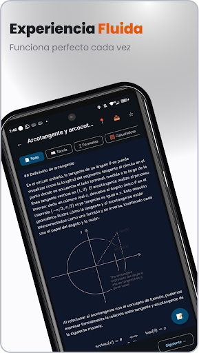
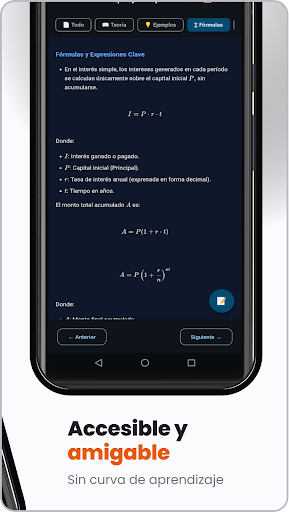

<!-- AppInitDev · README oficial de presentación · datos del catálogo facilitado -->

# MathApp: Aprende Matemáticas

**Repasa fórmulas de álgebra, geometría y trigonometría con ejercicios**

 
 

## Código Kotlin de referencia

| Dato | Valor |
|---|---|
| Paquete Android | `com.appinitdev.math` |
| Versión seleccionada en el rastreo | `4.0.11` |
| Procedencia de versión | Gradle activo |
| Archivos Kotlin incluidos | 29 |

**Alcance:** este repositorio contiene una **copia parcial de código Kotlin**, con declaraciones `package` e `import` retiradas y posibles credenciales ofuscadas. No incluye Gradle, librerías, recursos ni archivos de configuración y **no compila directamente**. La eliminación automática de secretos es heurística: revisa todos los archivos antes de publicarlos. No se concede una licencia abierta de código de manera automática.

### Carpetas con código Kotlin

- [`app/src/androidTest/java/com/appinitdev/math/`](app/src/androidTest/java/com/appinitdev/math/)
- [`app/src/main/java/com/appinitdev/math/`](app/src/main/java/com/appinitdev/math/)
- [`app/src/main/java/com/appinitdev/math/data/billing/`](app/src/main/java/com/appinitdev/math/data/billing/)
- [`app/src/main/java/com/appinitdev/math/data/database/`](app/src/main/java/com/appinitdev/math/data/database/)
- [`app/src/main/java/com/appinitdev/math/data/model/`](app/src/main/java/com/appinitdev/math/data/model/)
- [`app/src/main/java/com/appinitdev/math/data/repository/`](app/src/main/java/com/appinitdev/math/data/repository/)
- [`app/src/main/java/com/appinitdev/math/ui/components/`](app/src/main/java/com/appinitdev/math/ui/components/)
- [`app/src/main/java/com/appinitdev/math/ui/screens/`](app/src/main/java/com/appinitdev/math/ui/screens/)
- [`app/src/main/java/com/appinitdev/math/ui/theme/`](app/src/main/java/com/appinitdev/math/ui/theme/)
- [`app/src/main/java/com/appinitdev/math/ui/viewmodel/`](app/src/main/java/com/appinitdev/math/ui/viewmodel/)
- [`app/src/test/java/com/appinitdev/math/`](app/src/test/java/com/appinitdev/math/)

## En pocas palabras

Repasa matemáticas con MathApp y comprende las fórmulas con ejemplos prácticos. Consulta conceptos de álgebra, geometría y cálculo para estudiar a tu ritmo, preparar exámenes y reforzar lo aprendido.

**Ficha del proyecto**

| Dato | Información |
|---|---|
| Aplicación | MathApp: Aprende Matemáticas |
| Identificador Android | `com.appinitdev.math` |
| Categoría | Educación |
| Edición de catálogo | `math` |
| Disponibilidad | [Consultar la ficha de Google Play](https://play.google.com/store/apps/details?id=com.appinitdev.math&hl=es&gl=mx) |

## Funcionalidades destacadas

- Fórmulas Interactivas: Modifica variables y comprende la lógica matemática detrás de cada demostración gráfica.
- Temario Exhaustivo: Explora módulos organizados de álgebra lineal, geometría plana, trigonometría y cálculo diferencial.
- Ejercicios y cuestionarios: Repasa conceptos y pon a prueba tus conocimientos.
- Acceso Sin Conexión: Continúa tu ritmo de estudio estés donde estés, sin consumir datos móviles.

## Capturas de pantalla

<!-- APPINITDEV_IMAGEN_APPS_INICIO -->
Capturas originales de la aplicación, incorporadas desde el catálogo local de AppInitDev.

  
  
  
  

  
  
  
  

<!-- APPINITDEV_IMAGEN_APPS_FIN -->

## Primeros pasos

1. Selecciona la rama matemática que deseas reforzar en la biblioteca organizada.
2. Interactúa con conceptos visuales y ajusta los valores numéricos de las fórmulas.

## Ecosistema AppInitDev

Además de la aplicación Android, el sitio de AppInitDev reúne experiencias y recursos que ayudan a conocer el proyecto:

- **Micrositio:** [Abrir](https://math.appinitdev.com/)
- **Demostración:** [Abrir](https://appinitdev.com/demos/apps/math/)
- **Laboratorio interactivo:** [Abrir](https://appinitdev.com/suite/experiencias/math/)
- **Directorio del proyecto:** [Abrir](https://appinitdev.com/directorios/math/)
- **Estudio y recursos:** [Abrir](https://appinitdev.com/apps-relacionadas/estudios/math/)

### Herramientas web complementarias

Utilidades disponibles en el navegador para explorar temas relacionados; no son necesariamente funciones integradas en la app.

- [Ecuaciones cuadráticas](https://appinitdev.com/herramientas/ecuacion-cuadratica)
- [Ecuaciones lineales](https://appinitdev.com/herramientas/ecuacion-lineal)

### Guías relacionadas

- [Aprender fracciones ejemplos](https://appinitdev.com/guias/aprender-fracciones-ejemplos)
- [Aprender fracciones ejercicios](https://appinitdev.com/guias/aprender-fracciones-ejercicios)

## Descubre otras aplicaciones

- [ElementalHub: Tabla periódica — `periodictable`](https://periodictable.appinitdev.com/) · [Google Play](https://play.google.com/store/apps/details?id=com.appinitdev.periodictable&hl=es&gl=mx)
- [Functions: Calculadora Gráfica — `derivatives-free`](https://derivatives-free.appinitdev.com/) · [Google Play](https://play.google.com/store/apps/details?id=com.appinitdev.derivatives.free&hl=es&gl=mx)
- [Numerical Methods: Cálculo — `methods-free`](https://methods-free.appinitdev.com/) · [Google Play](https://play.google.com/store/apps/details?id=com.appinitdev.methods.free&hl=es&gl=mx)

## Enlaces de referencia

- [Google Play · MathApp: Aprende Matemáticas](https://play.google.com/store/apps/details?id=com.appinitdev.math&hl=es&gl=mx)
- [Portafolio AppInitDev](https://appinitdev.com/)
- [Todas las aplicaciones del desarrollador](https://play.google.com/store/apps/dev?id=6537616482020430815)
- [Herramientas web](https://appinitdev.com/herramientas/)
- [Guías y tutoriales](https://appinitdev.com/guias/)
- [Política de privacidad de la aplicación](https://appinitdev.com/privacy-policy?App=MathApp)
- [Video de presentación](https://www.youtube.com/watch?v=iKM2q1zsiHM)

## Contacto

¿Tienes comentarios o encontraste un problema? Puedes ponerte en contacto con el equipo desde [AppInitDev](https://appinitdev.com/contacts).

---
AppInitDev · Información basada en el catálogo facilitado (referencia: 21 de noviembre de 2026). Los precios, capturas, compatibilidad y disponibilidad pueden cambiar en Google Play. La exportación Kotlin de este repositorio es parcial y no equivale a un proyecto Android compilable.
