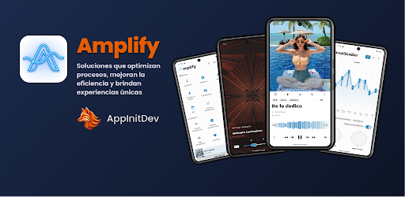
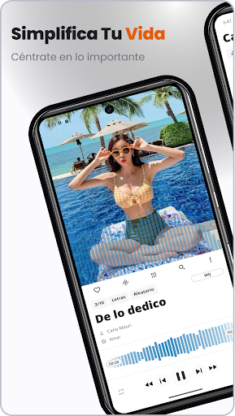
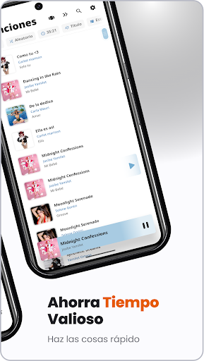
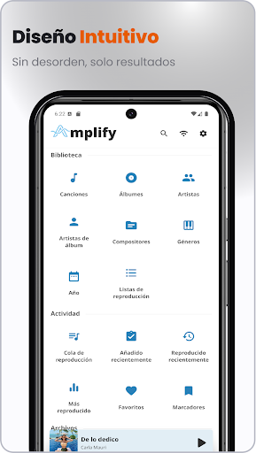
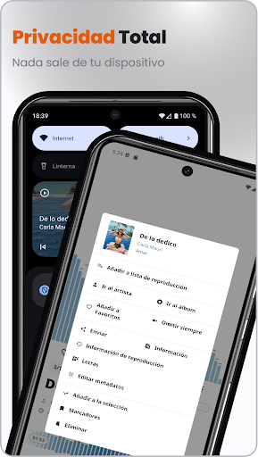
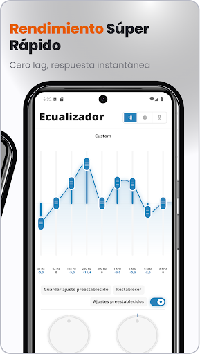
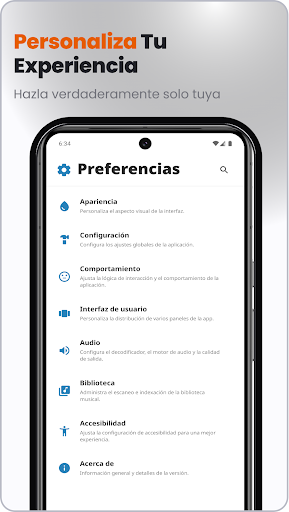
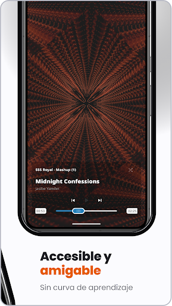

<!-- AppInitDev · README oficial de presentación · datos del catálogo facilitado -->

# Amplify: Reproductor Hi-Res

**Reproductor de música sin conexión con ecualizador de 10 bandas y FLAC.**

 
 

## Código Kotlin de referencia

| Dato | Valor |
|---|---|
| Paquete Android | `com.appinitdev.musicpro` |
| Versión seleccionada en el rastreo | `5.16.21_Pro` |
| Procedencia de versión | Gradle activo |
| Archivos Kotlin incluidos | 280 |

**Alcance:** este repositorio contiene una **copia parcial de código Kotlin**, con declaraciones `package` e `import` retiradas y posibles credenciales ofuscadas. No incluye Gradle, librerías, recursos ni archivos de configuración y **no compila directamente**. La eliminación automática de secretos es heurística: revisa todos los archivos antes de publicarlos. No se concede una licencia abierta de código de manera automática.

### Carpetas con código Kotlin

- [`music/src/androidTest/java/com/appinitdev/musicpro/`](music/src/androidTest/java/com/appinitdev/musicpro/)
- [`music/src/foss/java/com/appinitdev/musicpro/dialogs/app/`](music/src/foss/java/com/appinitdev/musicpro/dialogs/app/)
- [`music/src/foss/java/com/appinitdev/musicpro/ui/preferences/main/`](music/src/foss/java/com/appinitdev/musicpro/ui/preferences/main/)
- [`music/src/foss/java/com/appinitdev/musicpro/viewmodels/`](music/src/foss/java/com/appinitdev/musicpro/viewmodels/)
- [`music/src/main/java/com/appinitdev/musicpro/activities/`](music/src/main/java/com/appinitdev/musicpro/activities/)
- [`music/src/main/java/com/appinitdev/musicpro/adapters/dialogs/`](music/src/main/java/com/appinitdev/musicpro/adapters/dialogs/)
- [`music/src/main/java/com/appinitdev/musicpro/adapters/home/dashboard/`](music/src/main/java/com/appinitdev/musicpro/adapters/home/dashboard/)
- [`music/src/main/java/com/appinitdev/musicpro/adapters/home/main/`](music/src/main/java/com/appinitdev/musicpro/adapters/home/main/)
- [`music/src/main/java/com/appinitdev/musicpro/adapters/home/sub/`](music/src/main/java/com/appinitdev/musicpro/adapters/home/sub/)
- [`music/src/main/java/com/appinitdev/musicpro/adapters/player/`](music/src/main/java/com/appinitdev/musicpro/adapters/player/)
- [`music/src/main/java/com/appinitdev/musicpro/adapters/preference/`](music/src/main/java/com/appinitdev/musicpro/adapters/preference/)
- [`music/src/main/java/com/appinitdev/musicpro/adapters/ui/dialogs/`](music/src/main/java/com/appinitdev/musicpro/adapters/ui/dialogs/)
- [`music/src/main/java/com/appinitdev/musicpro/adapters/ui/lists/`](music/src/main/java/com/appinitdev/musicpro/adapters/ui/lists/)
- [`music/src/main/java/com/appinitdev/musicpro/adapters/ui/page/`](music/src/main/java/com/appinitdev/musicpro/adapters/ui/page/)
- [`music/src/main/java/com/appinitdev/musicpro/dialogs/albumartists/`](music/src/main/java/com/appinitdev/musicpro/dialogs/albumartists/)
- [`music/src/main/java/com/appinitdev/musicpro/dialogs/albums/`](music/src/main/java/com/appinitdev/musicpro/dialogs/albums/)
- Y 54 carpetas adicionales de Kotlin.

## En pocas palabras

Amplify reproduce archivos de música guardados en tu móvil. Ajusta el sonido con el ecualizador de 10 bandas y utiliza tu colección sin depender de un servicio de música en streaming.

**Ficha del proyecto**

| Dato | Información |
|---|---|
| Aplicación | Amplify: Reproductor Hi-Res |
| Identificador Android | `com.appinitdev.musicpro` |
| Categoría | Entretenimiento |
| Edición de catálogo | `musicpro` |
| Disponibilidad | [Consultar la ficha de Google Play](https://play.google.com/store/apps/details?id=com.appinitdev.musicpro&hl=es&gl=mx) |

## Funcionalidades destacadas

- Soporte Hi-Res y Formatos Sin Pérdida: Reproducción nativa de archivos FLAC, WAV, ALAC, MP3, OGG, M4A y OPUS con fidelidad de estudio.
- Ecualizador Profesional de 10 Bandas: Ajuste de frecuencias de +/-15 dB con control de ganancia de preamplificador para cada perfil acústico.
- Gestor de Metadatos y Etiquetas: Edición directa de etiquetas ID3 y Vorbis en el almacenamiento de tu dispositivo para mantener el orden.
- Sincronización de Letras LRC: Lectura ágil de texto incrustado, compatibilidad con archivos externos .lrc y listas de reproducción m3u.
- Reproducción Continua (Gapless): Transición fluida entre canciones sin pausas intermedias y con bajo impacto en la batería.
- Interfaz Adaptativa Material You: Diseño dinámico que sincroniza su gama cromática con la portada del álbum en reproducción.
- Motor DSP Avanzado: Procesamiento digital optimizado con ARM NEON para una espacialidad estéreo amplia, refuerzo de graves y saturación analógica.

## Capturas de pantalla

<!-- APPINITDEV_IMAGEN_APPS_INICIO -->
Capturas originales de la aplicación, incorporadas desde el catálogo local de AppInitDev.

  
  
  
  

  
  
  
  

<!-- APPINITDEV_IMAGEN_APPS_FIN -->

## Cómo empezar

1. Abre la [ficha oficial de Amplify: Reproductor Hi-Res](https://play.google.com/store/apps/details?id=com.appinitdev.musicpro&hl=es&gl=mx) y revisa la compatibilidad de tu dispositivo.
2. Instala la aplicación siguiendo las instrucciones de Google Play.
3. Explora sus funciones desde la interfaz de la aplicación.

## Ecosistema AppInitDev

Además de la aplicación Android, el sitio de AppInitDev reúne experiencias y recursos que ayudan a conocer el proyecto:

- **Micrositio:** [Abrir](https://musicpro.appinitdev.com/)
- **Demostración:** [Abrir](https://appinitdev.com/demos/apps/musicpro/)
- **Laboratorio interactivo:** [Abrir](https://appinitdev.com/suite/experiencias/musicpro/)
- **Directorio del proyecto:** [Abrir](https://appinitdev.com/directorios/musicpro/)
- **Estudio y recursos:** [Abrir](https://appinitdev.com/apps-relacionadas/estudios/musicpro/)

### Herramientas web complementarias

Utilidades disponibles en el navegador para explorar temas relacionados; no son necesariamente funciones integradas en la app.

- [Tamaño de un audio](https://appinitdev.com/herramientas/tamano-audio)
- [BPM a milisegundos](https://appinitdev.com/herramientas/bpm-a-ms)
- [Tamaño de audio PCM](https://appinitdev.com/herramientas/tamano-audio-pcm)
- [Información de audio](https://appinitdev.com/herramientas/audio-details)

### Guías relacionadas

- [Flac mp3 streaming diferencias android](https://appinitdev.com/guias/flac-mp3-streaming-diferencias-android)
- [Musica flac android offline](https://appinitdev.com/guias/musica-flac-android-offline)

## Descubre otras aplicaciones

- [Amplify: Reproductor Hi-Res — `amplify-free`](https://amplify-free.appinitdev.com/) · [Google Play](https://play.google.com/store/apps/details?id=com.appinitdev.music&hl=es&gl=mx)

## Enlaces de referencia

- [Google Play · Amplify: Reproductor Hi-Res](https://play.google.com/store/apps/details?id=com.appinitdev.musicpro&hl=es&gl=mx)
- [Portafolio AppInitDev](https://appinitdev.com/)
- [Todas las aplicaciones del desarrollador](https://play.google.com/store/apps/dev?id=6537616482020430815)
- [Herramientas web](https://appinitdev.com/herramientas/)
- [Guías y tutoriales](https://appinitdev.com/guias/)
- [Política de privacidad de la aplicación](https://appinitdev.com/privacy-policy?App=Amplify)

## Contacto

¿Tienes comentarios o encontraste un problema? Puedes ponerte en contacto con el equipo desde [AppInitDev](https://appinitdev.com/contacts).

---
AppInitDev · Información basada en el catálogo facilitado (referencia: 21 de noviembre de 2026). Los precios, capturas, compatibilidad y disponibilidad pueden cambiar en Google Play. La exportación Kotlin de este repositorio es parcial y no equivale a un proyecto Android compilable.
