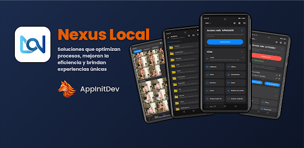
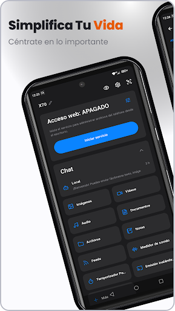
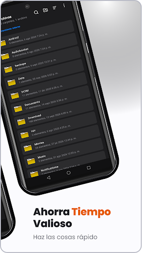
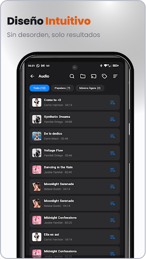
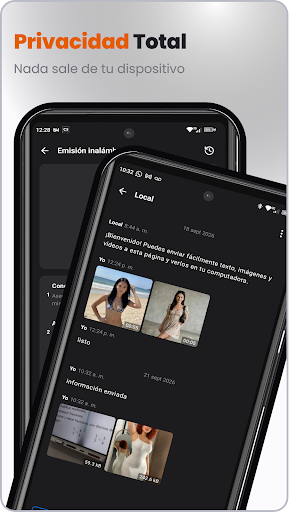
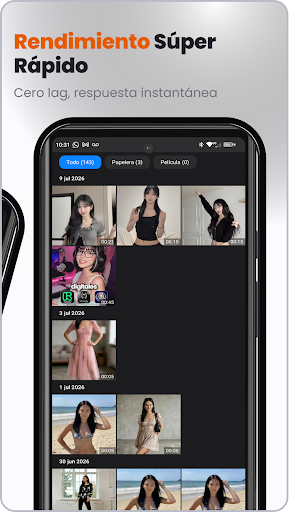
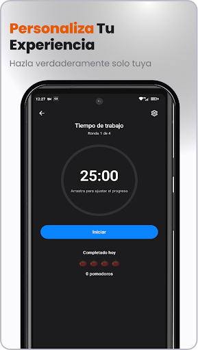
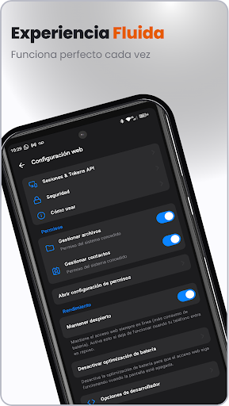
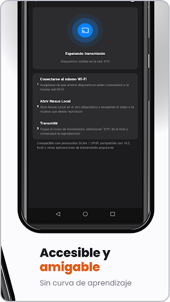

<!-- AppInitDev · README oficial de presentación · datos del catálogo facilitado -->

# Nexus Local: Gestor Web Wi-Fi

**Pasa archivos por Wi-Fi y visualiza la pantalla del móvil desde el navegador.**

 
 

## Código Kotlin de referencia

| Dato | Valor |
|---|---|
| Paquete Android | `com.appinitdev.nexusLocal` |
| Versión seleccionada en el rastreo | `1.0.7` |
| Procedencia de versión | Gradle activo |
| Archivos Kotlin incluidos | 870 |

**Alcance:** este repositorio contiene una **copia parcial de código Kotlin**, con declaraciones `package` e `import` retiradas y posibles credenciales ofuscadas. No incluye Gradle, librerías, recursos ni archivos de configuración y **no compila directamente**. La eliminación automática de secretos es heurística: revisa todos los archivos antes de publicarlos. No se concede una licencia abierta de código de manera automática.

### Carpetas con código Kotlin

- [`app/src/androidTest/java/com/appinitdev/nexusLocal/tests/`](app/src/androidTest/java/com/appinitdev/nexusLocal/tests/)
- [`app/src/fdroid/java/com/google/ai/edge/litert/`](app/src/fdroid/java/com/google/ai/edge/litert/)
- [`app/src/main/java/com/appinitdev/plain/`](app/src/main/java/com/appinitdev/plain/)
- [`app/src/main/java/com/appinitdev/plain/ai/`](app/src/main/java/com/appinitdev/plain/ai/)
- [`app/src/main/java/com/appinitdev/plain/api/`](app/src/main/java/com/appinitdev/plain/api/)
- [`app/src/main/java/com/appinitdev/plain/audio/`](app/src/main/java/com/appinitdev/plain/audio/)
- [`app/src/main/java/com/appinitdev/plain/chat/`](app/src/main/java/com/appinitdev/plain/chat/)
- [`app/src/main/java/com/appinitdev/plain/chat/channel/`](app/src/main/java/com/appinitdev/plain/chat/channel/)
- [`app/src/main/java/com/appinitdev/plain/chat/data/`](app/src/main/java/com/appinitdev/plain/chat/data/)
- [`app/src/main/java/com/appinitdev/plain/chat/download/`](app/src/main/java/com/appinitdev/plain/chat/download/)
- [`app/src/main/java/com/appinitdev/plain/chat/peer/`](app/src/main/java/com/appinitdev/plain/chat/peer/)
- [`app/src/main/java/com/appinitdev/plain/data/`](app/src/main/java/com/appinitdev/plain/data/)
- [`app/src/main/java/com/appinitdev/plain/db/`](app/src/main/java/com/appinitdev/plain/db/)
- [`app/src/main/java/com/appinitdev/plain/discover/`](app/src/main/java/com/appinitdev/plain/discover/)
- [`app/src/main/java/com/appinitdev/plain/docs/`](app/src/main/java/com/appinitdev/plain/docs/)
- [`app/src/main/java/com/appinitdev/plain/enums/`](app/src/main/java/com/appinitdev/plain/enums/)
- Y 82 carpetas adicionales de Kotlin.

## En pocas palabras

Gestiona los archivos de tu móvil Android desde el ordenador sin cables USB. Nexus Local ofrece acceso mediante un navegador web cuando ambos dispositivos están conectados a la misma red Wi-Fi.

**Ficha del proyecto**

| Dato | Información |
|---|---|
| Aplicación | Nexus Local: Gestor Web Wi-Fi |
| Identificador Android | `com.appinitdev.nexusLocal` |
| Categoría | Productividad |
| Edición de catálogo | `nexuslocal` |
| Disponibilidad | [Consultar la ficha de Google Play](https://play.google.com/store/apps/details?id=com.appinitdev.nexusLocal&hl=es&gl=mx) |

## Funcionalidades destacadas

- Explora carpetas del almacenamiento interno o de una tarjeta SD compatible y transfiere fotos, documentos y otros archivos entre el móvil y el PC o Mac.
- Muestra la pantalla del móvil en el navegador del ordenador. También puedes ver fotografías, escuchar audio y reproducir vídeos directamente, sin descargarlos previamente.
- Localiza imágenes de la galería mediante procesamiento de IA en el propio dispositivo. Redacta notas en Markdown, consulta fuentes RSS y comprueba los datos de batería y memoria RAM.

## Capturas de pantalla

<!-- APPINITDEV_IMAGEN_APPS_INICIO -->
Capturas originales de la aplicación, incorporadas desde el catálogo local de AppInitDev.

  
  
  
  

  
  
  
  

<!-- APPINITDEV_IMAGEN_APPS_FIN -->

## Primeros pasos

1. Conecta el móvil y el ordenador a la misma red Wi-Fi.
2. Abre Nexus Local y localiza la dirección que proporciona.
3. Introduce la dirección en el navegador y empieza a gestionar los archivos.

## Ecosistema AppInitDev

Además de la aplicación Android, el sitio de AppInitDev reúne experiencias y recursos que ayudan a conocer el proyecto:

- **Micrositio:** [Abrir](https://nexuslocal.appinitdev.com/)
- **Demostración:** [Abrir](https://appinitdev.com/demos/apps/nexuslocal/)
- **Laboratorio interactivo:** [Abrir](https://appinitdev.com/suite/experiencias/nexuslocal/)
- **Directorio del proyecto:** [Abrir](https://appinitdev.com/directorios/nexuslocal/)
- **Estudio y recursos:** [Abrir](https://appinitdev.com/apps-relacionadas/estudios/nexuslocal/)

### Herramientas web complementarias

Utilidades disponibles en el navegador para explorar temas relacionados; no son necesariamente funciones integradas en la app.

- [Estimador de tiempo de transferencia](https://appinitdev.com/herramientas/tiempo-descarga)
- [Conversor de tamaños de archivo](https://appinitdev.com/herramientas/bytes-legibles)
- [Identificador de formato](https://appinitdev.com/herramientas/detector-formato-archivo)

### Guías relacionadas

- [Organizar fotos wifi local](https://appinitdev.com/guias/organizar-fotos-wifi-local)
- [Pc no detecta movil red wifi soluciones](https://appinitdev.com/guias/pc-no-detecta-movil-red-wifi-soluciones)

## Descubre otras aplicaciones

- [Focusly: Temporizador Pomodoro — `goodtime`](https://goodtime.appinitdev.com/) · [Google Play](https://play.google.com/store/apps/details?id=com.appinitdev.goodtime&hl=es&gl=mx)
- [Notepad: Bloc de notas tareas — `notes-premium`](https://notes-premium.appinitdev.com/) · [Google Play](https://play.google.com/store/apps/details?id=com.appinitdev.notes.premium&hl=es&gl=mx)
- [Notepad: Bloc de notas tareas — `notes-free`](https://notes-free.appinitdev.com/) · [Google Play](https://play.google.com/store/apps/details?id=com.appinitdev.notes.free&hl=es&gl=mx)

## Enlaces de referencia

- [Google Play · Nexus Local: Gestor Web Wi-Fi](https://play.google.com/store/apps/details?id=com.appinitdev.nexusLocal&hl=es&gl=mx)
- [Portafolio AppInitDev](https://appinitdev.com/)
- [Todas las aplicaciones del desarrollador](https://play.google.com/store/apps/dev?id=6537616482020430815)
- [Herramientas web](https://appinitdev.com/herramientas/)
- [Guías y tutoriales](https://appinitdev.com/guias/)
- [Política de privacidad de la aplicación](https://appinitdev.com/privacy-policy?App=Nexus%20Local)

## Contacto

¿Tienes comentarios o encontraste un problema? Puedes ponerte en contacto con el equipo desde [AppInitDev](https://appinitdev.com/contacts).

---
AppInitDev · Información basada en el catálogo facilitado (referencia: 21 de noviembre de 2026). Los precios, capturas, compatibilidad y disponibilidad pueden cambiar en Google Play. La exportación Kotlin de este repositorio es parcial y no equivale a un proyecto Android compilable.
