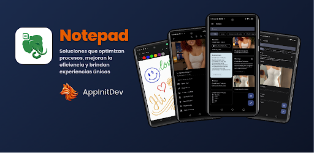
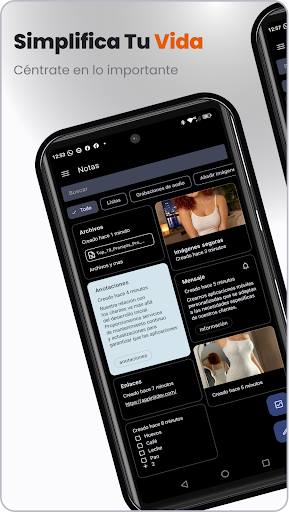
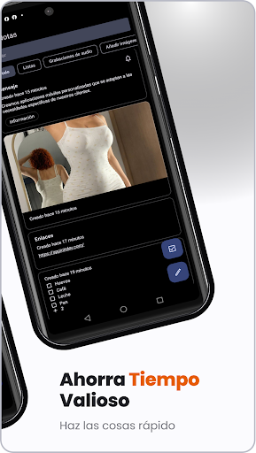
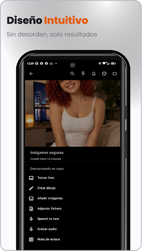
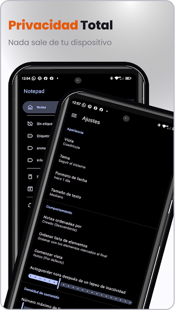
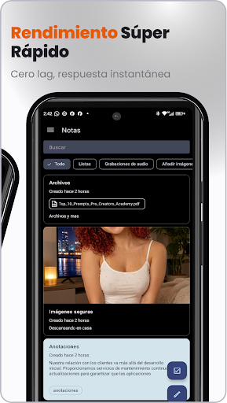
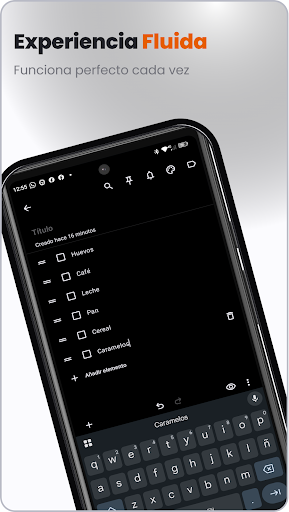
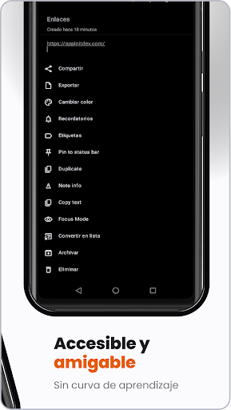

<!-- AppInitDev · README oficial de presentación · datos del catálogo facilitado -->

# Notepad: Bloc de notas tareas

**Apunta ideas, crea listas de tareas y organiza tus recordatorios diarios.**

 
 

## Código Kotlin de referencia

| Dato | Valor |
|---|---|
| Paquete Android | `com.appinitdev.notes.premium` |
| Versión seleccionada en el rastreo | `1.19` |
| Procedencia de versión | Gradle activo |
| Archivos Kotlin incluidos | 181 |

**Alcance:** este repositorio contiene una **copia parcial de código Kotlin**, con declaraciones `package` e `import` retiradas y posibles credenciales ofuscadas. No incluye Gradle, librerías, recursos ni archivos de configuración y **no compila directamente**. La eliminación automática de secretos es heurística: revisa todos los archivos antes de publicarlos. No se concede una licencia abierta de código de manera automática.

### Carpetas con código Kotlin

- [`app/src/androidTest/java/com/appinitdev/notes/premium/`](app/src/androidTest/java/com/appinitdev/notes/premium/)
- [`app/src/main/java/android/print/`](app/src/main/java/android/print/)
- [`app/src/main/java/androidx/recyclerview/widget/`](app/src/main/java/androidx/recyclerview/widget/)
- [`app/src/main/java/com/appinitdev/notes/`](app/src/main/java/com/appinitdev/notes/)
- [`app/src/main/java/com/appinitdev/notes/data/`](app/src/main/java/com/appinitdev/notes/data/)
- [`app/src/main/java/com/appinitdev/notes/data/dao/`](app/src/main/java/com/appinitdev/notes/data/dao/)
- [`app/src/main/java/com/appinitdev/notes/data/imports/`](app/src/main/java/com/appinitdev/notes/data/imports/)
- [`app/src/main/java/com/appinitdev/notes/data/imports/evernote/`](app/src/main/java/com/appinitdev/notes/data/imports/evernote/)
- [`app/src/main/java/com/appinitdev/notes/data/imports/google/`](app/src/main/java/com/appinitdev/notes/data/imports/google/)
- [`app/src/main/java/com/appinitdev/notes/data/imports/json/`](app/src/main/java/com/appinitdev/notes/data/imports/json/)
- [`app/src/main/java/com/appinitdev/notes/data/imports/txt/`](app/src/main/java/com/appinitdev/notes/data/imports/txt/)
- [`app/src/main/java/com/appinitdev/notes/data/model/`](app/src/main/java/com/appinitdev/notes/data/model/)
- [`app/src/main/java/com/appinitdev/notes/presentation/`](app/src/main/java/com/appinitdev/notes/presentation/)
- [`app/src/main/java/com/appinitdev/notes/presentation/activity/`](app/src/main/java/com/appinitdev/notes/presentation/activity/)
- [`app/src/main/java/com/appinitdev/notes/presentation/activity/main/`](app/src/main/java/com/appinitdev/notes/presentation/activity/main/)
- [`app/src/main/java/com/appinitdev/notes/presentation/activity/main/fragment/`](app/src/main/java/com/appinitdev/notes/presentation/activity/main/fragment/)
- Y 27 carpetas adicionales de Kotlin.

## En pocas palabras

Apunta ideas, prepara listas de la compra y organiza tus tareas con Notepad, un bloc de notas para Android pensado para escribir y consultar información sin complicaciones.

**Ficha del proyecto**

| Dato | Información |
|---|---|
| Aplicación | Notepad: Bloc de notas tareas |
| Identificador Android | `com.appinitdev.notes.premium` |
| Categoría | Productividad |
| Edición de catálogo | `notes-premium` |
| Disponibilidad | [Consultar la ficha de Google Play](https://play.google.com/store/apps/details?id=com.appinitdev.notes.premium&hl=es&gl=mx) |

## Funcionalidades destacadas

- Crea notas rápidas para clase, reuniones, recetas o proyectos personales.
- Utiliza negrita, cursiva y listas para estructurar tus apuntes.
- Incorpora fotos, documentos y archivos PDF a tus notas.
- Graba notas de voz cuando prefieras hablar en lugar de escribir.
- Crea listas de tareas con casillas para marcar lo que has terminado.
- Añade subtareas cuando necesites dividir una actividad en pasos.
- Programa recordatorios para los asuntos que requieran seguimiento.

## Capturas de pantalla

<!-- APPINITDEV_IMAGEN_APPS_INICIO -->
Capturas originales de la aplicación, incorporadas desde el catálogo local de AppInitDev.

  
  
  
  

  
  
  
  

<!-- APPINITDEV_IMAGEN_APPS_FIN -->

## Cómo empezar

1. Abre la [ficha oficial de Notepad: Bloc de notas tareas](https://play.google.com/store/apps/details?id=com.appinitdev.notes.premium&hl=es&gl=mx) y revisa la compatibilidad de tu dispositivo.
2. Instala la aplicación siguiendo las instrucciones de Google Play.
3. Explora sus funciones desde la interfaz de la aplicación.

## Ecosistema AppInitDev

Además de la aplicación Android, el sitio de AppInitDev reúne experiencias y recursos que ayudan a conocer el proyecto:

- **Micrositio:** [Abrir](https://notes-premium.appinitdev.com/)
- **Demostración:** [Abrir](https://appinitdev.com/demos/apps/notes-premium/)
- **Laboratorio interactivo:** [Abrir](https://appinitdev.com/suite/experiencias/notes-premium/)
- **Directorio del proyecto:** [Abrir](https://appinitdev.com/directorios/notes-premium/)
- **Estudio y recursos:** [Abrir](https://appinitdev.com/apps-relacionadas/estudios/notes-premium/)

### Herramientas web complementarias

Utilidades disponibles en el navegador para explorar temas relacionados; no son necesariamente funciones integradas en la app.

- [Organizador de tareas](https://appinitdev.com/herramientas/ordenar-tareas)
- [Contador de palabras](https://appinitdev.com/herramientas/contador-palabras)
- [Agenda de tiempo](https://appinitdev.com/herramientas/agenda-tiempo)

### Guías relacionadas

- [Metodo cornell notas android estudiar](https://appinitdev.com/guias/metodo-cornell-notas-android-estudiar)
- [Notas markdown android navegador](https://appinitdev.com/guias/notas-markdown-android-navegador)

## Descubre otras aplicaciones

- [Notepad: Bloc de notas tareas — `notes-free`](https://notes-free.appinitdev.com/) · [Google Play](https://play.google.com/store/apps/details?id=com.appinitdev.notes.free&hl=es&gl=mx)

## Enlaces de referencia

- [Google Play · Notepad: Bloc de notas tareas](https://play.google.com/store/apps/details?id=com.appinitdev.notes.premium&hl=es&gl=mx)
- [Portafolio AppInitDev](https://appinitdev.com/)
- [Todas las aplicaciones del desarrollador](https://play.google.com/store/apps/dev?id=6537616482020430815)
- [Herramientas web](https://appinitdev.com/herramientas/)
- [Guías y tutoriales](https://appinitdev.com/guias/)
- [Política de privacidad de la aplicación](https://appinitdev.com/privacy-policy?App=Notepad)
- [Video de presentación](https://www.youtube.com/watch?v=4HCR5I_I3L0)

## Contacto

¿Tienes comentarios o encontraste un problema? Puedes ponerte en contacto con el equipo desde [AppInitDev](https://appinitdev.com/contacts).

---
AppInitDev · Información basada en el catálogo facilitado (referencia: 21 de noviembre de 2026). Los precios, capturas, compatibilidad y disponibilidad pueden cambiar en Google Play. La exportación Kotlin de este repositorio es parcial y no equivale a un proyecto Android compilable.
