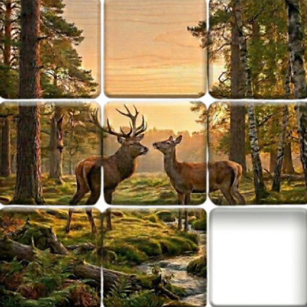
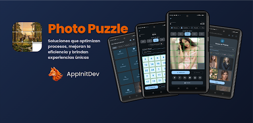
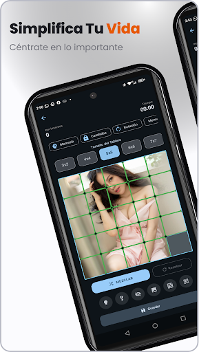
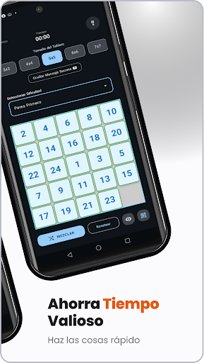
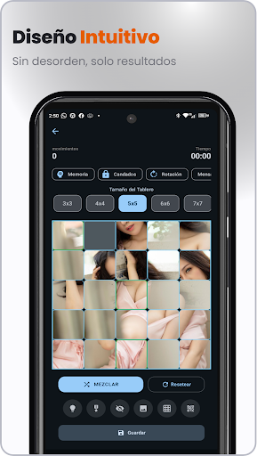
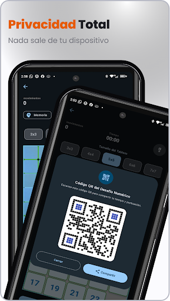
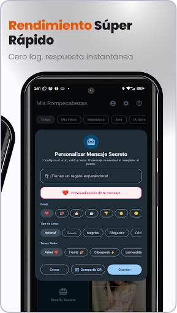
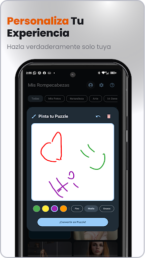
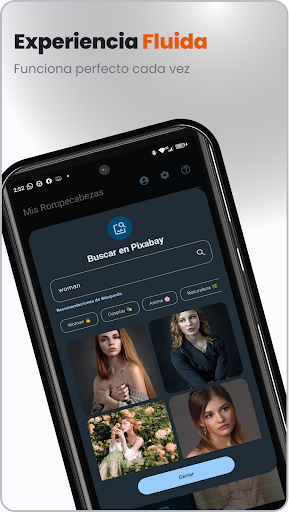
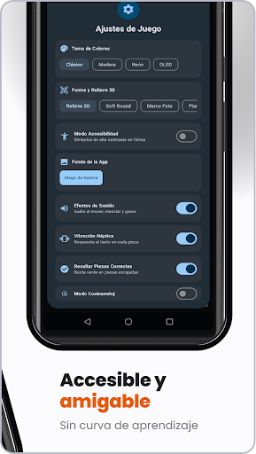

<!-- AppInitDev · README oficial de presentación · datos del catálogo facilitado -->

# Photo Puzzle: Puzle deslizante

**Crea puzles deslizantes con tus fotos y resuelve retos numéricos.**

 
 

## Código Kotlin de referencia

| Dato | Valor |
|---|---|
| Paquete Android | `com.appinitdev.puzzle.fre` |
| Versión seleccionada en el rastreo | `1.0.20` |
| Procedencia de versión | Gradle activo |
| Archivos Kotlin incluidos | 26 |

**Alcance:** este repositorio contiene una **copia parcial de código Kotlin**, con declaraciones `package` e `import` retiradas y posibles credenciales ofuscadas. No incluye Gradle, librerías, recursos ni archivos de configuración y **no compila directamente**. La eliminación automática de secretos es heurística: revisa todos los archivos antes de publicarlos. No se concede una licencia abierta de código de manera automática.

### Carpetas con código Kotlin

- [`app/src/androidTest/java/com/appinitdev/puzzle/`](app/src/androidTest/java/com/appinitdev/puzzle/)
- [`app/src/main/java/com/appinitdev/puzzle/`](app/src/main/java/com/appinitdev/puzzle/)
- [`app/src/main/java/com/appinitdev/puzzle/estadisticas/`](app/src/main/java/com/appinitdev/puzzle/estadisticas/)
- [`app/src/main/java/com/appinitdev/puzzle/gamification/`](app/src/main/java/com/appinitdev/puzzle/gamification/)
- [`app/src/main/java/com/appinitdev/puzzle/red/`](app/src/main/java/com/appinitdev/puzzle/red/)
- [`app/src/main/java/com/appinitdev/puzzle/ui/`](app/src/main/java/com/appinitdev/puzzle/ui/)
- [`app/src/main/java/com/appinitdev/puzzle/ui/theme/`](app/src/main/java/com/appinitdev/puzzle/ui/theme/)
- [`app/src/main/java/com/appinitdev/puzzle/util/`](app/src/main/java/com/appinitdev/puzzle/util/)
- [`app/src/test/java/com/appinitdev/puzzle/`](app/src/test/java/com/appinitdev/puzzle/)

## En pocas palabras

Crea un juego de taquín a partir de una foto de tu galería o resuelve puzles de números. Photo Puzzle ofrece ambos modos en tableros personalizables de 3x3 a 8x8.

**Ficha del proyecto**

| Dato | Información |
|---|---|
| Aplicación | Photo Puzzle: Puzle deslizante |
| Identificador Android | `com.appinitdev.puzzle.fre` |
| Categoría | Puzles |
| Edición de catálogo | `puzzle-free` |
| Disponibilidad | [Consultar la ficha de Google Play](https://play.google.com/store/apps/details?id=com.appinitdev.puzzle.fre&hl=es&gl=mx) |

## Funcionalidades destacadas

- Crea un juego de taquín a partir de una foto de tu galería o resuelve puzles de números. Photo Puzzle ofrece ambos modos en tableros personalizables de 3x3 a 8x8.
- Selecciona una fotografía propia o una imagen de la colección integrada. Desliza las piezas a la casilla vacía hasta recomponer la imagen.
- Prueba distintas ordenaciones, como espiral, diagonal, secuencia inversa o simetría. Ajusta la cuadrícula a la dificultad que prefieras.
- Consulta una miniatura, muestra la imagen de fondo o numera las piezas. Para tableros de 3x3 y 4x4 hay una demostración de resolución automática.
- Comprueba tus mejores tiempos y el número de movimientos, guarda el progreso y retoma una partida cuando quieras.
- Elige el modo, ajusta la cuadrícula y desplaza las piezas hacia el hueco libre hasta completar el reto.

## Capturas de pantalla

<!-- APPINITDEV_IMAGEN_APPS_INICIO -->
Capturas originales de la aplicación, incorporadas desde el catálogo local de AppInitDev.

  
  
  
  

  
  
  
  

<!-- APPINITDEV_IMAGEN_APPS_FIN -->

## Cómo empezar

1. Abre la [ficha oficial de Photo Puzzle: Puzle deslizante](https://play.google.com/store/apps/details?id=com.appinitdev.puzzle.fre&hl=es&gl=mx) y revisa la compatibilidad de tu dispositivo.
2. Instala la aplicación siguiendo las instrucciones de Google Play.
3. Explora sus funciones desde la interfaz de la aplicación.

## Ecosistema AppInitDev

Además de la aplicación Android, el sitio de AppInitDev reúne experiencias y recursos que ayudan a conocer el proyecto:

- **Micrositio:** [Abrir](https://puzzle-free.appinitdev.com/)
- **Demostración:** [Abrir](https://appinitdev.com/demos/apps/puzzle-free/)
- **Laboratorio interactivo:** [Abrir](https://appinitdev.com/suite/experiencias/puzzle-free/)
- **Directorio del proyecto:** [Abrir](https://appinitdev.com/directorios/puzzle-free/)
- **Estudio y recursos:** [Abrir](https://appinitdev.com/apps-relacionadas/estudios/puzzle-free/)

### Herramientas web complementarias

Utilidades disponibles en el navegador para explorar temas relacionados; no son necesariamente funciones integradas en la app.

- [Comprobar puzle resoluble](https://appinitdev.com/herramientas/puzzle-resoluble)
- [Movimientos de puzle](https://appinitdev.com/herramientas/puzzle-movimientos)
- [Celdas de un puzle](https://appinitdev.com/herramientas/puzzle-celdas)

### Guías relacionadas

- 
- [Crear puzzles fotos familiares consejos](https://appinitdev.com/guias/crear-puzzles-fotos-familiares-consejos)

## Enlaces de referencia

- [Google Play · Photo Puzzle: Puzle deslizante](https://play.google.com/store/apps/details?id=com.appinitdev.puzzle.fre&hl=es&gl=mx)
- [Portafolio AppInitDev](https://appinitdev.com/)
- [Todas las aplicaciones del desarrollador](https://play.google.com/store/apps/dev?id=6537616482020430815)
- [Herramientas web](https://appinitdev.com/herramientas/)
- [Guías y tutoriales](https://appinitdev.com/guias/)
- [Política de privacidad de la aplicación](https://appinitdev.com/privacy-policy?App=Photo%20Puzzle)

## Contacto

¿Tienes comentarios o encontraste un problema? Puedes ponerte en contacto con el equipo desde [AppInitDev](https://appinitdev.com/contacts).

---
AppInitDev · Información basada en el catálogo facilitado (referencia: 21 de noviembre de 2026). Los precios, capturas, compatibilidad y disponibilidad pueden cambiar en Google Play. La exportación Kotlin de este repositorio es parcial y no equivale a un proyecto Android compilable.
