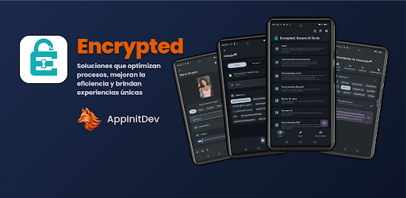
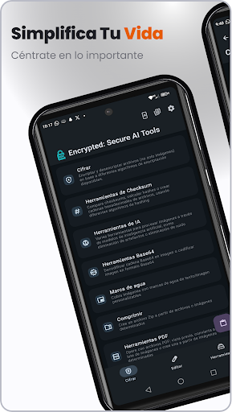
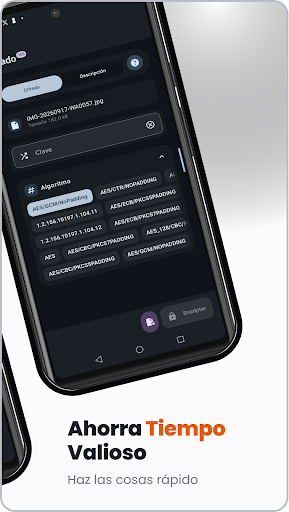
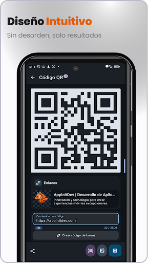
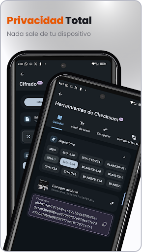
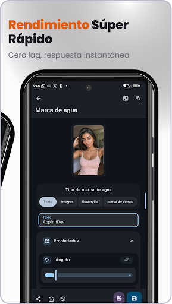
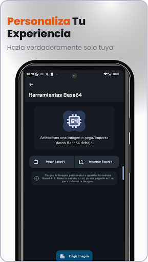
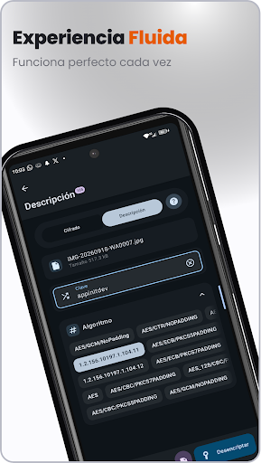
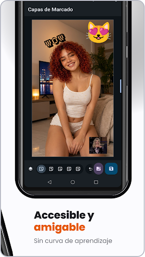

<!-- AppInitDev · README oficial de presentación · datos del catálogo facilitado -->

# Encrypted: Cifrado de Archivos

**Cifra archivos, borra metadatos EXIF y digitaliza documentos mediante OCR.**

 
 

## Código Kotlin de referencia

| Dato | Valor |
|---|---|
| Paquete Android | `com.appinitdev.pyrotechnics.premium` |
| Versión seleccionada en el rastreo | `1.10.25_Premium` |
| Procedencia de versión | Gradle activo |
| Archivos Kotlin incluidos | 13 |

**Alcance:** este repositorio contiene una **copia parcial de código Kotlin**, con declaraciones `package` e `import` retiradas y posibles credenciales ofuscadas. No incluye Gradle, librerías, recursos ni archivos de configuración y **no compila directamente**. La eliminación automática de secretos es heurística: revisa todos los archivos antes de publicarlos. No se concede una licencia abierta de código de manera automática.

### Carpetas con código Kotlin

- [`app/src/main/java/com/t8rin/imagetoolbox/app/presentation/`](app/src/main/java/com/t8rin/imagetoolbox/app/presentation/)
- [`app/src/main/java/com/t8rin/imagetoolbox/app/presentation/components/`](app/src/main/java/com/t8rin/imagetoolbox/app/presentation/components/)
- [`app/src/main/java/com/t8rin/imagetoolbox/app/presentation/components/functions/`](app/src/main/java/com/t8rin/imagetoolbox/app/presentation/components/functions/)
- [`app/src/main/java/com/t8rin/imagetoolbox/app/presentation/components/utils/`](app/src/main/java/com/t8rin/imagetoolbox/app/presentation/components/utils/)

## En pocas palabras

Encrypted agrupa en Android herramientas de cifrado, revisión de metadatos y tratamiento de documentos. Protege ficheros seleccionados y prepara fotografías para compartir con mayor control sobre su información integrada.

**Ficha del proyecto**

| Dato | Información |
|---|---|
| Aplicación | Encrypted: Cifrado de Archivos |
| Identificador Android | `com.appinitdev.pyrotechnics.premium` |
| Categoría | Herramientas |
| Edición de catálogo | `encrypted` |
| Disponibilidad | [Consultar la ficha de Google Play](https://play.google.com/store/apps/details?id=com.appinitdev.pyrotechnics.premium&hl=es&gl=mx) |

## Funcionalidades destacadas

- Cifrado: trabaja con documentos y otros ficheros mediante los métodos ofrecidos por la aplicación.
- Metadatos EXIF: revisa y elimina campos compatibles, como la ubicación GPS, la fecha o el modelo de cámara.
- Comprobaciones: utiliza hashes para comparar la integridad de los archivos.
- OCR y PDF: reconoce texto en imágenes, convierte fotografías a PDF y consulta códigos QR.
- Edición de imágenes: accede a herramientas de recorte de fondos, reducción de ruido y esteganografía.

## Capturas de pantalla

<!-- APPINITDEV_IMAGEN_APPS_INICIO -->
Capturas originales de la aplicación, incorporadas desde el catálogo local de AppInitDev.

  
  
  
  

  
  
  
  

<!-- APPINITDEV_IMAGEN_APPS_FIN -->

## Cómo empezar

1. Abre la [ficha oficial de Encrypted: Cifrado de Archivos](https://play.google.com/store/apps/details?id=com.appinitdev.pyrotechnics.premium&hl=es&gl=mx) y revisa la compatibilidad de tu dispositivo.
2. Instala la aplicación siguiendo las instrucciones de Google Play.
3. Explora sus funciones desde la interfaz de la aplicación.

## Ecosistema AppInitDev

Además de la aplicación Android, el sitio de AppInitDev reúne experiencias y recursos que ayudan a conocer el proyecto:

- **Micrositio:** [Abrir](https://encrypted.appinitdev.com/)
- **Demostración:** [Abrir](https://appinitdev.com/demos/apps/encrypted/)
- **Laboratorio interactivo:** [Abrir](https://appinitdev.com/suite/experiencias/encrypted/)
- **Directorio del proyecto:** [Abrir](https://appinitdev.com/directorios/encrypted/)
- **Estudio y recursos:** [Abrir](https://appinitdev.com/apps-relacionadas/estudios/encrypted/)

### Herramientas web complementarias

Utilidades disponibles en el navegador para explorar temas relacionados; no son necesariamente funciones integradas en la app.

- [Eliminar datos EXIF](https://appinitdev.com/herramientas/imagen-remove-exif)
- [Contraseñas aleatorias](https://appinitdev.com/herramientas/contrasena-aleatoria)
- [Codificador Base64 de archivos](https://appinitdev.com/herramientas/archivo-a-base64)

### Guías relacionadas

- [Backup 321 archivos cifrados android](https://appinitdev.com/guias/backup-321-archivos-cifrados-android)
- [Compartir documentos cifrados](https://appinitdev.com/guias/compartir-documentos-cifrados)

## Descubre otras aplicaciones

- [FileManager: Gestor Archivos — `file-explorer`](https://file-explorer.appinitdev.com/) · [Google Play](https://play.google.com/store/apps/details?id=com.appinitdev.fileExplorer&hl=es&gl=mx)
- [FileManager: Gestor Archivos — `file-manager-free`](https://file-manager-free.appinitdev.com/) · [Google Play](https://play.google.com/store/apps/details?id=com.appinitdev.filefree&hl=es&gl=mx)
- [TesterApp: Pruebas Beta App — `testers`](https://testers.appinitdev.com/) · [Google Play](https://play.google.com/store/apps/details?id=com.appinitdev.tester&hl=es&gl=mx)

## Enlaces de referencia

- [Google Play · Encrypted: Cifrado de Archivos](https://play.google.com/store/apps/details?id=com.appinitdev.pyrotechnics.premium&hl=es&gl=mx)
- [Portafolio AppInitDev](https://appinitdev.com/)
- [Todas las aplicaciones del desarrollador](https://play.google.com/store/apps/dev?id=6537616482020430815)
- [Herramientas web](https://appinitdev.com/herramientas/)
- [Guías y tutoriales](https://appinitdev.com/guias/)
- [Política de privacidad de la aplicación](https://appinitdev.com/privacy-policy?App=Encrypted)
- [Video de presentación](https://www.youtube.com/watch?v=6DHzoReYsE0)

## Contacto

¿Tienes comentarios o encontraste un problema? Puedes ponerte en contacto con el equipo desde [AppInitDev](https://appinitdev.com/contacts).

---
AppInitDev · Información basada en el catálogo facilitado (referencia: 21 de noviembre de 2026). Los precios, capturas, compatibilidad y disponibilidad pueden cambiar en Google Play. La exportación Kotlin de este repositorio es parcial y no equivale a un proyecto Android compilable.
