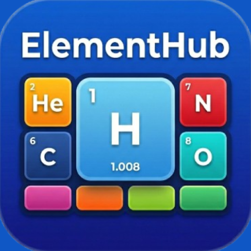
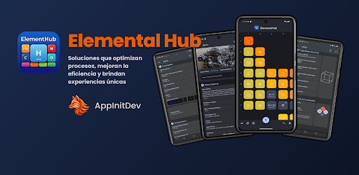
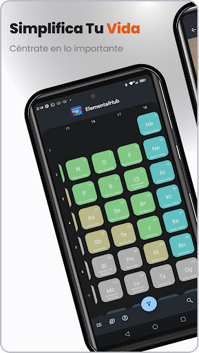
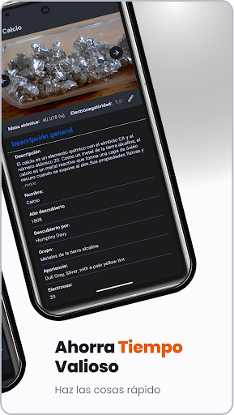
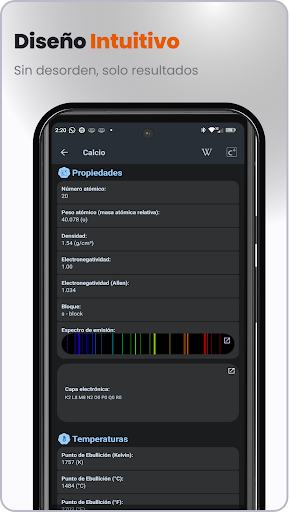
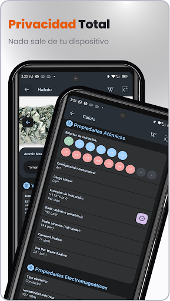
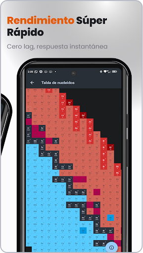
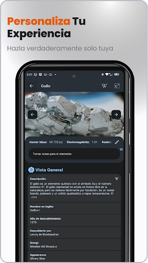
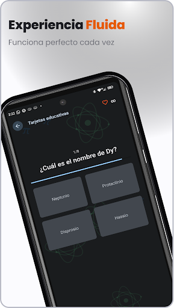
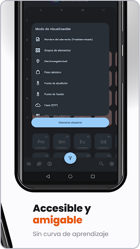

<!-- AppInitDev · README oficial de presentación · datos del catálogo facilitado -->

# ElementalHub: Tabla periódica

**Tabla periódica interactiva y cálculo de masa molar sin conexión.**

 
 

## Código Kotlin de referencia

| Dato | Valor |
|---|---|
| Paquete Android | `com.appinitdev.table` |
| Versión seleccionada en el rastreo | `1.1.17_Pro` |
| Procedencia de versión | Gradle activo |
| Archivos Kotlin incluidos | 143 |

**Alcance:** este repositorio contiene una **copia parcial de código Kotlin**, con declaraciones `package` e `import` retiradas y posibles credenciales ofuscadas. No incluye Gradle, librerías, recursos ni archivos de configuración y **no compila directamente**. La eliminación automática de secretos es heurística: revisa todos los archivos antes de publicarlos. No se concede una licencia abierta de código de manera automática.

### Carpetas con código Kotlin

- [`app/src/androidTest/java/com/appinitdev/science/`](app/src/androidTest/java/com/appinitdev/science/)
- [`app/src/main/java/com/appinitdev/science/`](app/src/main/java/com/appinitdev/science/)
- [`app/src/main/java/com/appinitdev/science/activities/`](app/src/main/java/com/appinitdev/science/activities/)
- [`app/src/main/java/com/appinitdev/science/activities/settings/`](app/src/main/java/com/appinitdev/science/activities/settings/)
- [`app/src/main/java/com/appinitdev/science/activities/tables/`](app/src/main/java/com/appinitdev/science/activities/tables/)
- [`app/src/main/java/com/appinitdev/science/activities/tools/`](app/src/main/java/com/appinitdev/science/activities/tools/)
- [`app/src/main/java/com/appinitdev/science/adapter/`](app/src/main/java/com/appinitdev/science/adapter/)
- [`app/src/main/java/com/appinitdev/science/animations/`](app/src/main/java/com/appinitdev/science/animations/)
- [`app/src/main/java/com/appinitdev/science/auth/`](app/src/main/java/com/appinitdev/science/auth/)
- [`app/src/main/java/com/appinitdev/science/classes/`](app/src/main/java/com/appinitdev/science/classes/)
- [`app/src/main/java/com/appinitdev/science/extensions/`](app/src/main/java/com/appinitdev/science/extensions/)
- [`app/src/main/java/com/appinitdev/science/model/`](app/src/main/java/com/appinitdev/science/model/)
- [`app/src/main/java/com/appinitdev/science/preferences/`](app/src/main/java/com/appinitdev/science/preferences/)
- [`app/src/main/java/com/appinitdev/science/settings/`](app/src/main/java/com/appinitdev/science/settings/)
- [`app/src/main/java/com/appinitdev/science/sync/`](app/src/main/java/com/appinitdev/science/sync/)
- [`app/src/main/java/com/appinitdev/science/utils/`](app/src/main/java/com/appinitdev/science/utils/)
- Y 4 carpetas adicionales de Kotlin.

## En pocas palabras

ElementalHub combina la tabla periódica de los elementos con una calculadora de masa molar y datos de química. Consulta configuraciones electrónicas, propiedades atómicas e isótopos durante tus estudios.

**Ficha del proyecto**

| Dato | Información |
|---|---|
| Aplicación | ElementalHub: Tabla periódica |
| Identificador Android | `com.appinitdev.table` |
| Categoría | Educación |
| Edición de catálogo | `elementalhub` |
| Disponibilidad | [Consultar la ficha de Google Play](https://play.google.com/store/apps/details?id=com.appinitdev.table&hl=es&gl=mx) |

## Funcionalidades destacadas

- Tabla Periódica Interactiva: Configuración electrónica, masa atómica y orbitales.
- Calculadora de Masa Molar: Resolución instantánea de pesos moleculares y fórmulas.
- Diccionario de Química: Términos, leyes fundamentales y definiciones clave.
- Funcionamiento Offline: Acceso total a los registros sin depender de conexión a internet.

## Capturas de pantalla

<!-- APPINITDEV_IMAGEN_APPS_INICIO -->
Capturas originales de la aplicación, incorporadas desde el catálogo local de AppInitDev.

  
  
  
  

  
  
  
  

<!-- APPINITDEV_IMAGEN_APPS_FIN -->

## Cómo empezar

1. Abre la [ficha oficial de ElementalHub: Tabla periódica](https://play.google.com/store/apps/details?id=com.appinitdev.table&hl=es&gl=mx) y revisa la compatibilidad de tu dispositivo.
2. Instala la aplicación siguiendo las instrucciones de Google Play.
3. Explora sus funciones desde la interfaz de la aplicación.

## Ecosistema AppInitDev

Además de la aplicación Android, el sitio de AppInitDev reúne experiencias y recursos que ayudan a conocer el proyecto:

- **Micrositio:** [Abrir](https://elementalhub.appinitdev.com/)
- **Demostración:** [Abrir](https://appinitdev.com/demos/apps/elementalhub/)
- **Laboratorio interactivo:** [Abrir](https://appinitdev.com/suite/experiencias/elementalhub/)
- **Directorio del proyecto:** [Abrir](https://appinitdev.com/directorios/elementalhub/)
- **Estudio y recursos:** [Abrir](https://appinitdev.com/apps-relacionadas/estudios/elementalhub/)

### Herramientas web complementarias

Utilidades disponibles en el navegador para explorar temas relacionados; no son necesariamente funciones integradas en la app.

- [Calculadora de masa molar](https://appinitdev.com/herramientas/masa-molar-elemento)
- [Calculadora de molaridad](https://appinitdev.com/herramientas/molaridad)

### Guías relacionadas

- [Aprender tabla periodica](https://appinitdev.com/guias/aprender-tabla-periodica)
- [Grupos periodos tabla periodica](https://appinitdev.com/guias/grupos-periodos-tabla-periodica)

## Descubre otras aplicaciones

- [ElementalHub: Tabla periódica — `periodictable`](https://periodictable.appinitdev.com/) · [Google Play](https://play.google.com/store/apps/details?id=com.appinitdev.periodictable&hl=es&gl=mx)

## Enlaces de referencia

- [Google Play · ElementalHub: Tabla periódica](https://play.google.com/store/apps/details?id=com.appinitdev.table&hl=es&gl=mx)
- [Portafolio AppInitDev](https://appinitdev.com/)
- [Todas las aplicaciones del desarrollador](https://play.google.com/store/apps/dev?id=6537616482020430815)
- [Herramientas web](https://appinitdev.com/herramientas/)
- [Guías y tutoriales](https://appinitdev.com/guias/)
- [Política de privacidad de la aplicación](https://appinitdev.com/privacy-policy?App=Elemental%20Hub)
- [Video de presentación](https://www.youtube.com/watch?v=VhIlLuKtJFE)

## Contacto

¿Tienes comentarios o encontraste un problema? Puedes ponerte en contacto con el equipo desde [AppInitDev](https://appinitdev.com/contacts).

---
AppInitDev · Información basada en el catálogo facilitado (referencia: 21 de noviembre de 2026). Los precios, capturas, compatibilidad y disponibilidad pueden cambiar en Google Play. La exportación Kotlin de este repositorio es parcial y no equivale a un proyecto Android compilable.
