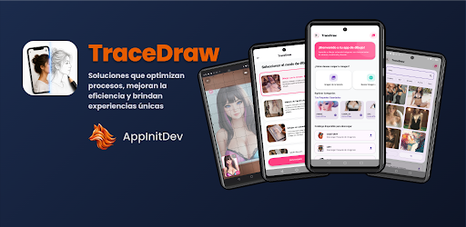
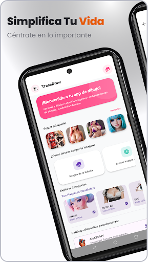
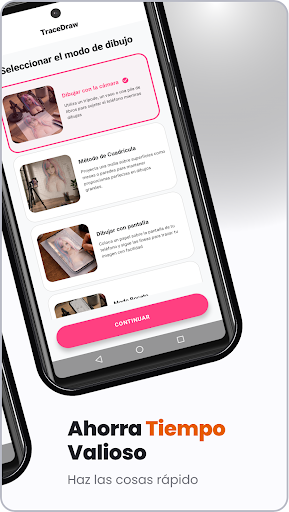
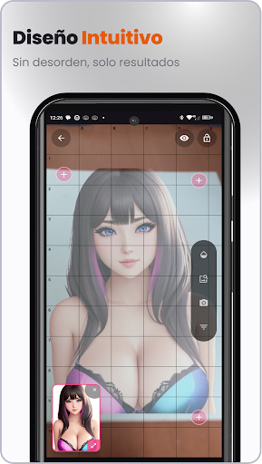
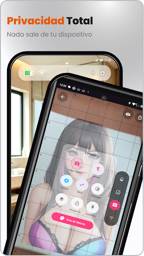
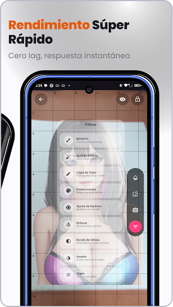
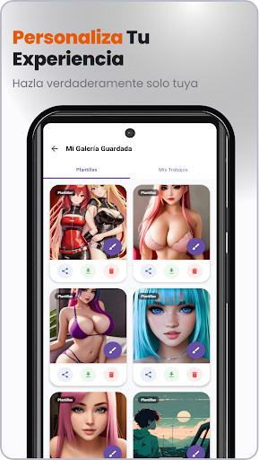
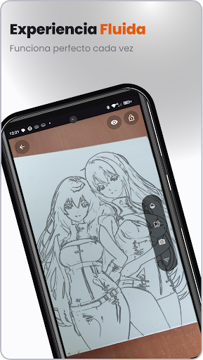
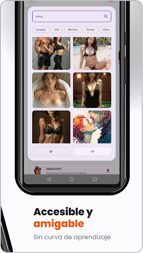

<!-- AppInitDev · README oficial de presentación · datos del catálogo facilitado -->

# TraceDraw: Calcar y Dibujar

**Calca fotos en papel con la cámara, cuadrícula y guías de boceto.**

 
 

## Código Kotlin de referencia

| Dato | Valor |
|---|---|
| Paquete Android | `com.appinitdev.trace` |
| Versión seleccionada en el rastreo | `1.0.0_free` |
| Procedencia de versión | Gradle activo |
| Archivos Kotlin incluidos | 20 |

**Alcance:** este repositorio contiene una **copia parcial de código Kotlin**, con declaraciones `package` e `import` retiradas y posibles credenciales ofuscadas. No incluye Gradle, librerías, recursos ni archivos de configuración y **no compila directamente**. La eliminación automática de secretos es heurística: revisa todos los archivos antes de publicarlos. No se concede una licencia abierta de código de manera automática.

### Carpetas con código Kotlin

- [`app/src/androidTest/java/com/appinitdev/draw/premium/`](app/src/androidTest/java/com/appinitdev/draw/premium/)
- [`app/src/main/java/com/appinitdev/draw/premium/`](app/src/main/java/com/appinitdev/draw/premium/)
- [`app/src/main/java/com/appinitdev/draw/premium/BD/`](app/src/main/java/com/appinitdev/draw/premium/BD/)
- [`app/src/main/java/com/appinitdev/draw/premium/funciones/`](app/src/main/java/com/appinitdev/draw/premium/funciones/)
- [`app/src/main/java/com/appinitdev/draw/premium/gallery/`](app/src/main/java/com/appinitdev/draw/premium/gallery/)
- [`app/src/main/java/com/appinitdev/draw/premium/home/`](app/src/main/java/com/appinitdev/draw/premium/home/)
- [`app/src/main/java/com/appinitdev/draw/premium/image/`](app/src/main/java/com/appinitdev/draw/premium/image/)
- [`app/src/main/java/com/appinitdev/draw/premium/mode/`](app/src/main/java/com/appinitdev/draw/premium/mode/)
- [`app/src/main/java/com/appinitdev/draw/premium/panel/`](app/src/main/java/com/appinitdev/draw/premium/panel/)
- [`app/src/test/java/com/appinitdev/draw/premium/`](app/src/test/java/com/appinitdev/draw/premium/)

## En pocas palabras

📷 Calco con cámara: La imagen de referencia se superpone a la vista de la cámara en la pantalla del móvil para ayudarte a trazar sus contornos en papel.

**Ficha del proyecto**

| Dato | Información |
|---|---|
| Aplicación | TraceDraw: Calcar y Dibujar |
| Identificador Android | `com.appinitdev.trace` |
| Categoría | Arte y diseño |
| Edición de catálogo | `trace` |
| Disponibilidad | [Consultar la ficha de Google Play](https://play.google.com/store/apps/details?id=com.appinitdev.trace&hl=es&gl=mx) |

## Funcionalidades destacadas

- Calco con cámara: La imagen de referencia se superpone a la vista de la cámara en la pantalla del móvil para ayudarte a trazar sus contornos en papel.
- Modo pantalla: Emplea la pantalla de tu móvil como mesa de luz para practicar contornos y proporciones básicas.
- Modo cuadrícula: Añade guías cuadriculadas para escalar y transferir dibujos a lienzos o paredes con exactitud.
- ✏️ Modo boceto lineal: Transforma tus fotografías en esquemas lineales limpios para facilitar el trazado a lápiz.
- Ajustes de precisión: Regula opacidad, rotación, bloqueo de enfoque, escala de grises e inversión de color.
- Importación completa: Escoge fotografías de tu galería local, explora en la web o usa colecciones temáticas.

## Capturas de pantalla

<!-- APPINITDEV_IMAGEN_APPS_INICIO -->
Capturas originales de la aplicación, incorporadas desde el catálogo local de AppInitDev.

  
  
  
  

  
  
  
  

<!-- APPINITDEV_IMAGEN_APPS_FIN -->

## Primeros pasos

1. Selecciona una referencia visual desde tu galería o el catálogo interno.
2. Configura la transparencia adecuada, amplía el encuadre y activa la cuadrícula si la requieres.
3. Coloca el teléfono en un soporte fijo o trípode apuntando directamente a tu bloc de papel.
4. Observa la pantalla, repasa las líneas guía sobre la hoja y finaliza tu obra a mano alzada.

## Ecosistema AppInitDev

Además de la aplicación Android, el sitio de AppInitDev reúne experiencias y recursos que ayudan a conocer el proyecto:

- **Micrositio:** [Abrir](https://trace.appinitdev.com/)
- **Demostración:** [Abrir](https://appinitdev.com/demos/apps/trace/)
- **Estudio y recursos:** [Abrir](https://appinitdev.com/apps-relacionadas/estudios/trace/)

### Herramientas web complementarias

Utilidades disponibles en el navegador para explorar temas relacionados; no son necesariamente funciones integradas en la app.

- [Fotografía a contornos](https://appinitdev.com/herramientas/foto-a-contorno-local/)
- [Imagen en escala de grises](https://appinitdev.com/herramientas/imagen-grayscale)
- [Ajuste de contraste](https://appinitdev.com/herramientas/imagen-contrast)
- [Cambiar tamaño](https://appinitdev.com/herramientas/imagen-resize)

### Guías relacionadas

- [Dibujar manos referencias fotos](https://appinitdev.com/guias/dibujar-manos-referencias-fotos)
- [Calcar dibujos camara android](https://appinitdev.com/guias/calcar-dibujos-camara-android)

## Descubre otras aplicaciones

- [TraceDraw: Calcar y Dibujar — `draw`](https://draw.appinitdev.com/) · [Google Play](https://play.google.com/store/apps/details?id=com.appinitdev.draw&hl=es&gl=mx)

## Enlaces de referencia

- [Google Play · TraceDraw: Calcar y Dibujar](https://play.google.com/store/apps/details?id=com.appinitdev.trace&hl=es&gl=mx)
- [Portafolio AppInitDev](https://appinitdev.com/)
- [Todas las aplicaciones del desarrollador](https://play.google.com/store/apps/dev?id=6537616482020430815)
- [Herramientas web](https://appinitdev.com/herramientas/)
- [Guías y tutoriales](https://appinitdev.com/guias/)
- [Política de privacidad de la aplicación](https://appinitdev.com/privacy-policy?App=TraceDraw)

## Contacto

¿Tienes comentarios o encontraste un problema? Puedes ponerte en contacto con el equipo desde [AppInitDev](https://appinitdev.com/contacts).

---
AppInitDev · Información basada en el catálogo facilitado (referencia: 21 de noviembre de 2026). Los precios, capturas, compatibilidad y disponibilidad pueden cambiar en Google Play. La exportación Kotlin de este repositorio es parcial y no equivale a un proyecto Android compilable.
