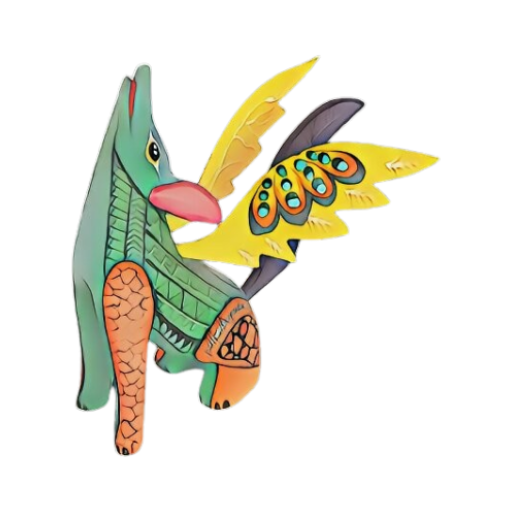
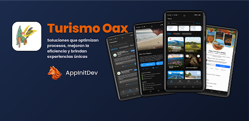
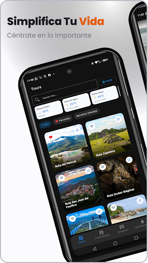
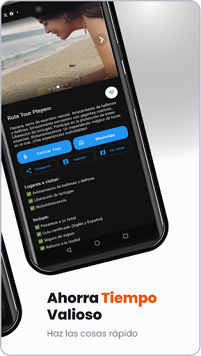
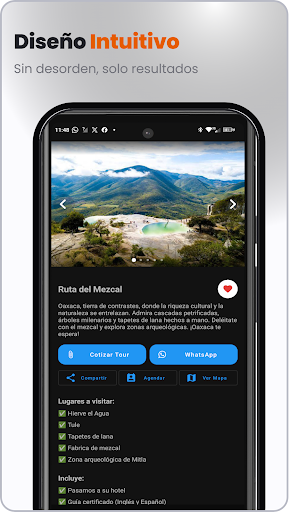
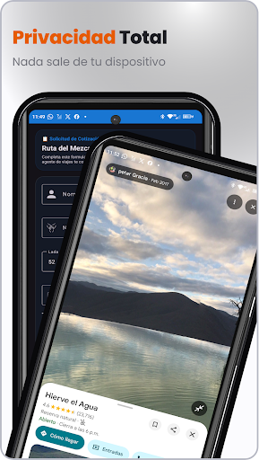
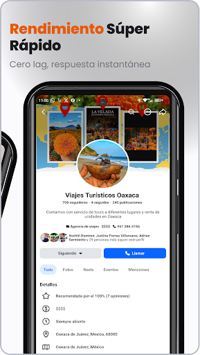
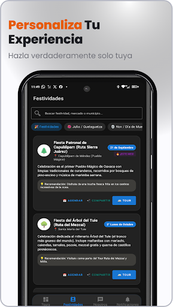
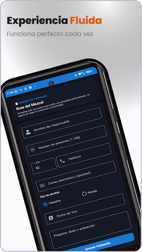
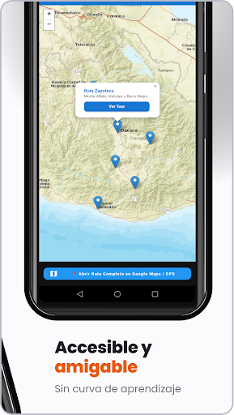

<!-- AppInitDev · README oficial de presentación · datos del catálogo facilitado -->

# Turismo Oaxaca: Guía de Viaje

**Guía de Oaxaca: visitas, alquiler de coches y rutas por México.**

 
 

## Código Kotlin de referencia

| Dato | Valor |
|---|---|
| Paquete Android | `com.appinitdev.turismoOax` |
| Versión seleccionada en el rastreo | `1.4.14` |
| Procedencia de versión | Gradle activo |
| Archivos Kotlin incluidos | 40 |

**Alcance:** este repositorio contiene una **copia parcial de código Kotlin**, con declaraciones `package` e `import` retiradas y posibles credenciales ofuscadas. No incluye Gradle, librerías, recursos ni archivos de configuración y **no compila directamente**. La eliminación automática de secretos es heurística: revisa todos los archivos antes de publicarlos. No se concede una licencia abierta de código de manera automática.

### Carpetas con código Kotlin

- [`app/src/androidTest/java/com/appinitdev/turismoOax/`](app/src/androidTest/java/com/appinitdev/turismoOax/)
- [`app/src/main/java/com/appinitdev/turismoOax/`](app/src/main/java/com/appinitdev/turismoOax/)
- [`app/src/main/java/com/appinitdev/turismoOax/BD/`](app/src/main/java/com/appinitdev/turismoOax/BD/)
- [`app/src/main/java/com/appinitdev/turismoOax/adapter/`](app/src/main/java/com/appinitdev/turismoOax/adapter/)
- [`app/src/main/java/com/appinitdev/turismoOax/buy/`](app/src/main/java/com/appinitdev/turismoOax/buy/)
- [`app/src/main/java/com/appinitdev/turismoOax/model/`](app/src/main/java/com/appinitdev/turismoOax/model/)
- [`app/src/main/java/com/appinitdev/turismoOax/network/`](app/src/main/java/com/appinitdev/turismoOax/network/)
- [`app/src/main/java/com/appinitdev/turismoOax/service/`](app/src/main/java/com/appinitdev/turismoOax/service/)
- [`app/src/main/java/com/appinitdev/turismoOax/ui/dashboard/`](app/src/main/java/com/appinitdev/turismoOax/ui/dashboard/)
- [`app/src/main/java/com/appinitdev/turismoOax/ui/festividades/`](app/src/main/java/com/appinitdev/turismoOax/ui/festividades/)
- [`app/src/main/java/com/appinitdev/turismoOax/ui/home/`](app/src/main/java/com/appinitdev/turismoOax/ui/home/)
- [`app/src/main/java/com/appinitdev/turismoOax/ui/notifications/`](app/src/main/java/com/appinitdev/turismoOax/ui/notifications/)
- [`app/src/main/java/com/appinitdev/turismoOax/viewmodel/`](app/src/main/java/com/appinitdev/turismoOax/viewmodel/)
- [`app/src/test/java/com/appinitdev/turismoOax/`](app/src/test/java/com/appinitdev/turismoOax/)

## En pocas palabras

Descubre Oaxaca y prepara tu viaje a México con ideas de excursiones y alternativas para desplazarte.

**Ficha del proyecto**

| Dato | Información |
|---|---|
| Aplicación | Turismo Oaxaca: Guía de Viaje |
| Identificador Android | `com.appinitdev.turismoOax` |
| Categoría | Viajes y guías |
| Edición de catálogo | `turismooax` |
| Disponibilidad | [Consultar la ficha de Google Play](https://play.google.com/store/apps/details?id=com.appinitdev.turismoOax&hl=es&gl=mx) |

## Funcionalidades destacadas

- Explora visitas privadas y propuestas de itinerarios adaptados a tus intereses.
- Consulta opciones de alquiler de coches para tu estancia.
- Organiza tu visita a lugares como Hierve el Agua y Monte Albán.

> **Nota importante:** Comprueba la disponibilidad y las condiciones vigentes de excursiones o servicios antes de reservar.

## Capturas de pantalla

<!-- APPINITDEV_IMAGEN_APPS_INICIO -->
Capturas originales de la aplicación, incorporadas desde el catálogo local de AppInitDev.

  
  
  
  

  
  
  
  

<!-- APPINITDEV_IMAGEN_APPS_FIN -->

## Cómo empezar

1. Abre la [ficha oficial de Turismo Oaxaca: Guía de Viaje](https://play.google.com/store/apps/details?id=com.appinitdev.turismoOax&hl=es&gl=mx) y revisa la compatibilidad de tu dispositivo.
2. Instala la aplicación siguiendo las instrucciones de Google Play.
3. Explora sus funciones desde la interfaz de la aplicación.

## Ecosistema AppInitDev

Además de la aplicación Android, el sitio de AppInitDev reúne experiencias y recursos que ayudan a conocer el proyecto:

- **Micrositio:** [Abrir](https://turismooax.appinitdev.com/)
- **Demostración:** [Abrir](https://appinitdev.com/demos/apps/turismooax/)
- **Laboratorio interactivo:** [Abrir](https://appinitdev.com/suite/experiencias/turismooax/)
- **Directorio del proyecto:** [Abrir](https://appinitdev.com/directorios/turismooax/)
- **Estudio y recursos:** [Abrir](https://appinitdev.com/apps-relacionadas/estudios/turismooax/)

### Herramientas web complementarias

Utilidades disponibles en el navegador para explorar temas relacionados; no son necesariamente funciones integradas en la app.

- [Presupuesto de viaje](https://appinitdev.com/herramientas/presupuesto-viaje)
- [Gasto diario de viaje](https://appinitdev.com/herramientas/presupuesto-viaje-diario)
- [Tiempo de carretera](https://appinitdev.com/herramientas/tiempo-carretera)

### Guías relacionadas

- [Oaxaca temporada lluvias equipaje rutas](https://appinitdev.com/guias/oaxaca-temporada-lluvias-equipaje-rutas)
- [Que visitar oaxaca primera vez](https://appinitdev.com/guias/que-visitar-oaxaca-primera-vez)

## Enlaces de referencia

- [Google Play · Turismo Oaxaca: Guía de Viaje](https://play.google.com/store/apps/details?id=com.appinitdev.turismoOax&hl=es&gl=mx)
- [Portafolio AppInitDev](https://appinitdev.com/)
- [Todas las aplicaciones del desarrollador](https://play.google.com/store/apps/dev?id=6537616482020430815)
- [Herramientas web](https://appinitdev.com/herramientas/)
- [Guías y tutoriales](https://appinitdev.com/guias/)
- [Política de privacidad de la aplicación](https://appinitdev.com/privacy-policy?App=Turismo%20Oaxaca)
- [Video de presentación](https://www.youtube.com/watch?v=XJkEJTwpXZg)

## Contacto

¿Tienes comentarios o encontraste un problema? Puedes ponerte en contacto con el equipo desde [AppInitDev](https://appinitdev.com/contacts).

---
AppInitDev · Información basada en el catálogo facilitado (referencia: 21 de noviembre de 2026). Los precios, capturas, compatibilidad y disponibilidad pueden cambiar en Google Play. La exportación Kotlin de este repositorio es parcial y no equivale a un proyecto Android compilable.
