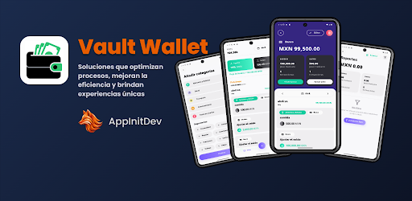
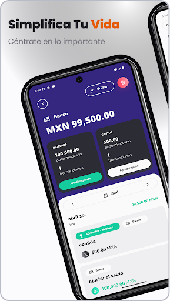
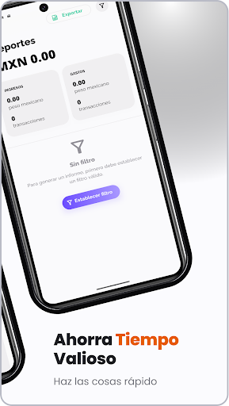
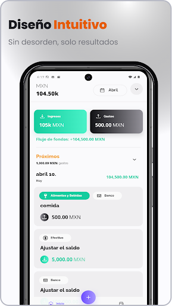
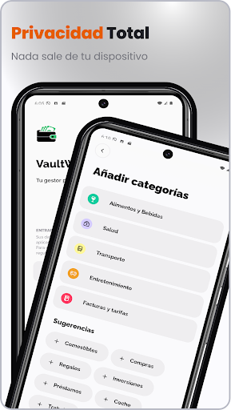
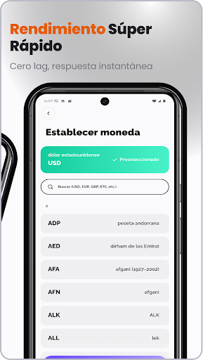
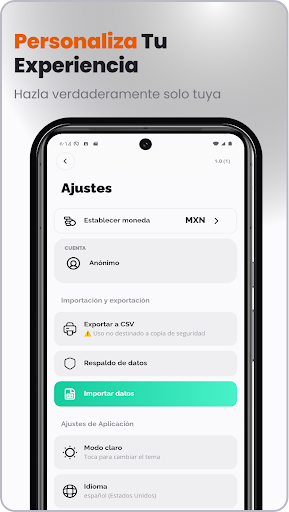
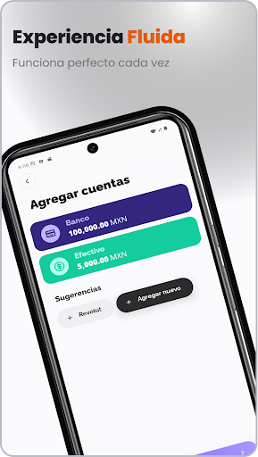
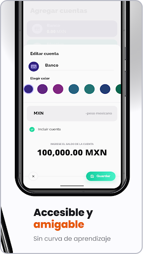

<!-- AppInitDev · README oficial de presentación · datos del catálogo facilitado -->

# Vault Wallet: Control Gastos

**Registra gastos y organiza tu presupuesto personal en una sola app.**

 
 

## Código Kotlin de referencia

| Dato | Valor |
|---|---|
| Paquete Android | `com.appinitdev.wallet` |
| Versión seleccionada en el rastreo | `1.0.2` |
| Procedencia de versión | Gradle activo |
| Archivos Kotlin incluidos | 11 |

**Alcance:** este repositorio contiene una **copia parcial de código Kotlin**, con declaraciones `package` e `import` retiradas y posibles credenciales ofuscadas. No incluye Gradle, librerías, recursos ni archivos de configuración y **no compila directamente**. La eliminación automática de secretos es heurística: revisa todos los archivos antes de publicarlos. No se concede una licencia abierta de código de manera automática.

### Carpetas con código Kotlin

- [`app/src/main/java/com/ivy/`](app/src/main/java/com/ivy/)
- [`app/src/main/java/com/ivy/wallet/`](app/src/main/java/com/ivy/wallet/)
- [`app/src/main/java/com/ivy/wallet/di/`](app/src/main/java/com/ivy/wallet/di/)
- [`app/src/main/java/com/ivy/wallet/migrations/`](app/src/main/java/com/ivy/wallet/migrations/)
- [`app/src/main/java/com/ivy/wallet/migrations/impl/`](app/src/main/java/com/ivy/wallet/migrations/impl/)
- [`app/src/main/java/com/ivy/wallet/ui/applocked/`](app/src/main/java/com/ivy/wallet/ui/applocked/)

## En pocas palabras

Vault Wallet es un gestor de gastos para llevar las cuentas del día a día. Registra ingresos y pagos de forma manual, configura presupuestos por categorías y consulta informes para entender tus gastos.

**Ficha del proyecto**

| Dato | Información |
|---|---|
| Aplicación | Vault Wallet: Control Gastos |
| Identificador Android | `com.appinitdev.wallet` |
| Categoría | Finanzas |
| Edición de catálogo | `wallet` |
| Disponibilidad | [Consultar la ficha de Google Play](https://play.google.com/store/apps/details?id=com.appinitdev.wallet&hl=es&gl=mx) |

## Funcionalidades destacadas

- Control multicuentas: Registra manualmente efectivo, cuentas corrientes y criptoactivos en un solo lugar.
- Categorías personalizadas: Organiza tu flujo monetario con iconos y colores representativos.
- Presupuestos inteligentes: Establece límites de gasto por categoría para revisar tus gastos frente al presupuesto.
- Informes concisos: Filtra tu histórico de movimientos y exporta tus reportes en formato CSV o Excel.
- Pagos planificados: Anticipa recibos periódicos, suscripciones fijas y gastos mensuales futuros.
- Soporte multidivisa: Registra operaciones en EUR, USD, GBP y criptomonedas como BTC y ETH.
- Widget de acceso directo: Registra pagos en efectivo con un solo toque desde la pantalla de inicio.

## Capturas de pantalla

<!-- APPINITDEV_IMAGEN_APPS_INICIO -->
Capturas originales de la aplicación, incorporadas desde el catálogo local de AppInitDev.

  
  
  
  

  
  
  
  

<!-- APPINITDEV_IMAGEN_APPS_FIN -->

## Cómo empezar

1. Abre la [ficha oficial de Vault Wallet: Control Gastos](https://play.google.com/store/apps/details?id=com.appinitdev.wallet&hl=es&gl=mx) y revisa la compatibilidad de tu dispositivo.
2. Instala la aplicación siguiendo las instrucciones de Google Play.
3. Explora sus funciones desde la interfaz de la aplicación.

## Ecosistema AppInitDev

Además de la aplicación Android, el sitio de AppInitDev reúne experiencias y recursos que ayudan a conocer el proyecto:

- **Micrositio:** [Abrir](https://wallet.appinitdev.com/)
- **Demostración:** [Abrir](https://appinitdev.com/demos/apps/wallet/)
- **Laboratorio interactivo:** [Abrir](https://appinitdev.com/suite/experiencias/wallet/)
- **Directorio del proyecto:** [Abrir](https://appinitdev.com/directorios/wallet/)
- **Estudio y recursos:** [Abrir](https://appinitdev.com/apps-relacionadas/estudios/wallet/)

### Herramientas web complementarias

Utilidades disponibles en el navegador para explorar temas relacionados; no son necesariamente funciones integradas en la app.

- [Regla de presupuesto 50/30/20](https://appinitdev.com/herramientas/presupuesto-50-30-20)
- [Detector de pequeños gastos](https://appinitdev.com/herramientas/gasto-hormiga)
- [Análisis de gastos por día](https://appinitdev.com/herramientas/gastos-por-dia)
- [Plan de ahorro de emergencia](https://appinitdev.com/herramientas/ahorro-emergencia)

### Guías relacionadas

- [Presupuesto 50 30 20 ingresos variables](https://appinitdev.com/guias/presupuesto-50-30-20-ingresos-variables)
- [Presupuesto mensual celular](https://appinitdev.com/guias/presupuesto-mensual-celular)

## Descubre otras aplicaciones

- [POSManager: TPV y Caja Ventas — `posmanager-free`](https://posmanager-free.appinitdev.com/) · [Google Play](https://play.google.com/store/apps/details?id=com.appinitdev.posmanager.free&hl=es&gl=mx)
- [POSManager: TPV y Caja Ventas — `posmanager`](https://posmanager.appinitdev.com/) · [Google Play](https://play.google.com/store/apps/details?id=com.appinitdev.posmanager&hl=es&gl=mx)

## Enlaces de referencia

- [Google Play · Vault Wallet: Control Gastos](https://play.google.com/store/apps/details?id=com.appinitdev.wallet&hl=es&gl=mx)
- [Portafolio AppInitDev](https://appinitdev.com/)
- [Todas las aplicaciones del desarrollador](https://play.google.com/store/apps/dev?id=6537616482020430815)
- [Herramientas web](https://appinitdev.com/herramientas/)
- [Guías y tutoriales](https://appinitdev.com/guias/)
- [Política de privacidad de la aplicación](https://appinitdev.com/privacy-policy?App=Vault%20Wallet)

## Contacto

¿Tienes comentarios o encontraste un problema? Puedes ponerte en contacto con el equipo desde [AppInitDev](https://appinitdev.com/contacts).

---
AppInitDev · Información basada en el catálogo facilitado (referencia: 21 de noviembre de 2026). Los precios, capturas, compatibilidad y disponibilidad pueden cambiar en Google Play. La exportación Kotlin de este repositorio es parcial y no equivale a un proyecto Android compilable.
